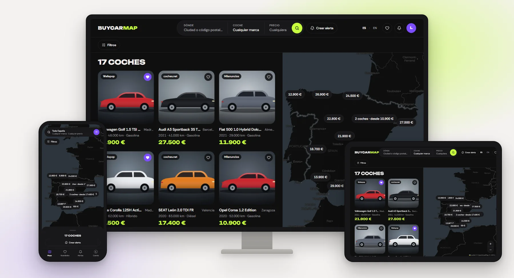

# BuyCarMap

Second-hand car listings from Wallapop, coches.net and Milanuncios, merged into one search and
plotted on a map of Spain.

<picture>
  <source media="(prefers-color-scheme: dark)" srcset="docs/images/hero-map-dark.webp">
  
</picture>

## Highlights

- **One search, three marketplaces.** Wallapop, coches.net and Milanuncios are searched together
  and merged into one result list; if a source is down, the others still render.
- **One set of filters for every source**: location and radius, price, make and model, fuel,
  gearbox, maximum mileage, minimum year and recency. Horsepower is no longer offered; old links
  that carry it still work.
- **A card list and a map that stay in sync**, with a price pin for each car.
- **Saved cars**: keep the listings you like, with their own map, at `/favorites`.
- **Email alerts**: save a search and get a digest when new cars match it, with one-click
  unsubscribe.
- **Accounts**: email and password with verification and reset, two-factor authentication,
  optional Google sign-in, and a download of your own data.
- **Spanish and English**, Spanish by default.

None of the three offers a public API: each is wired into the server-side search
(`server/search/service.ts`, ADR 0016) and normalised into one shared listing shape. Milanuncios
answers 405 to requests from Vercel, so production gets no Milanuncios listings
([#52](https://github.com/algusaem/buycarmap/issues/52)); the code stays.

## Design

BuyCarMap 2.0 is built on a documented design system — colour and type tokens, components and a UI
kit — kept in [`docs/design/`](docs/design/README.md). Every screen was designed first, on a canvas,
and only once the design was approved was it specified and built. [The 2.0 redesign](docs/design/redesign-2.0.md)
tells the story and shows each screen before and after.

## Contents

- [Quickstart](#quickstart) · [Stack](#stack)
- [Getting started](#getting-started): [prerequisites](#prerequisites),
  [environment](#the-minimum-env), [worktrees](#working-in-a-worktree), [commands](#commands),
  [production setup](#production-setup-upstash-qstash), [git hooks](#git-hooks),
  [Claude commands](#claude-commands-and-checks), [troubleshooting](#when-something-is-wrong)
- [Documentation](#documentation): [what lives where](#what-lives-where), [index](#index),
  [specs](#specs), [decisions](#decisions)
- [Contributing](#contributing) · [What CI enforces](#what-ci-enforces)
- [Ownership map](#ownership-map)

## Quickstart

```bash
pnpm install
cp .env.example .env      # fill in BETTER_AUTH_SECRET; DATABASE_URL's default already points at Compose
pnpm db:up                # start the local Postgres (needs Docker Desktop running)
pnpm exec prisma generate
pnpm db:branch && pnpm db:seed
pnpm dev
```

The product is at `http://localhost:3000/map`.

Only those two environment variables are required; everything else disables a
feature rather than blocking the app. Working in a git worktree needs one extra
step — see [Getting started](#getting-started), which also covers why
`prisma generate` is separate and what to do when a command refuses to run.

## Stack

Next.js 16 (App Router) · React 19 · TypeScript · PostgreSQL on Neon via Prisma 7 · Better Auth
(sessions in Postgres) · next-intl · nuqs · React Hook Form + Zod 4 · Tailwind CSS 4 with Radix
primitives · Motion · Leaflet + react-leaflet · Upstash Redis and QStash · Resend + react-email ·
Pino · Sentry · Vitest · Playwright.

## Getting started

From a fresh clone to a running app is the [Quickstart](#quickstart) above:
roughly ten minutes, most of it waiting for `pnpm install`. This section is what
those commands do not tell you.

### Prerequisites

- **Node 22.18+** (`.nvmrc` pins the exact version; `STACK.md` §1) and **pnpm 11**, pinned in
  `package.json`'s `packageManager` — an older pnpm hands the install over to it. The lockfile is
  `pnpm-lock.yaml` and there is no `package-lock.json` — npm and yarn will resolve a different tree.
- **Docker Desktop**, with **WSL 2** on Windows, running before `pnpm db:up` or `pnpm db:branch`.
  Local work and the integration tests (Testcontainers) both run against the Postgres it starts —
  nothing here needs a Neon account or network access. There is no local Redis: without
  `UPSTASH_REDIS_REST_URL`/`UPSTASH_REDIS_REST_TOKEN`, rate limiting disables itself (one warning,
  every request allowed) rather than reaching a Redis whose Lua scripts a local Redis would reject
  anyway (`@upstash/ratelimit` relies on an Upstash-only extension). Production and preview still
  run on Neon and Upstash; see
  [Environments and operations](docs/ARCHITECTURE.md#environments-and-operations).
- **gitleaks** on your PATH — `winget install Gitleaks.Gitleaks` on Windows, `brew install gitleaks`
  on macOS. The pre-commit hook runs it.

### Why `prisma generate` is separate

The Prisma client is generated into `app/generated/prisma`, which is gitignored.
Nothing prompts you for it, and skipping it fails in a way that points at the
wrong thing: **four test files fail at *import* while every test that does run
passes.** That reads like an unrelated breakage rather than a missing bootstrap
step. `pnpm build` runs it for you; `pnpm dev`, `pnpm typecheck` and `pnpm test` do not.

### The minimum env

Only `DATABASE_URL` and `BETTER_AUTH_SECRET` are required — `lib/env.ts` validates
them at import and throws at boot rather than failing later with an opaque
error. Everything else is optional and **degrades a feature rather than breaking
the app**, which is deliberate, so a contributor is never blocked on credentials
they do not need. What each variable does when it is absent is in
[Environment variables](docs/ARCHITECTURE.md#environment-variables);
`.env.example` is the full reference, with the reasoning next to each entry.

In Vercel (Production and Preview), set `BETTER_AUTH_SECRET` to the **current**
`NEXTAUTH_SECRET` value, not a freshly generated one — the alert unsubscribe
tokens are HMACs keyed on it, and a new secret would stop every link already
sent from matching its stored hash ([ADR 0018](docs/decisions/0018-better-auth.md)).

### Working in a worktree

**Before any Prisma command or `pnpm dev` from a git worktree, run `pnpm db:up` then
`pnpm db:branch`.** `db:up` starts the local Compose Postgres (Docker Desktop must be running);
`db:branch` gives the current git branch its own database inside it and writes `DATABASE_URL` into
that worktree's `.env`, seeding the rest of the file from the main checkout. It is idempotent —
re-running on an already provisioned database reuses it.

```bash
pnpm db:up            # start the local Postgres, once per machine session
pnpm db:branch        # this git branch gets its own database
pnpm db:branch:rm     # delete it once the work is merged
pnpm db:seed          # fill it with development data (users, favorites, alerts)
```

A worktree starts with neither `.env` nor `node_modules`, so the full bootstrap there is:

```bash
pnpm db:branch && pnpm install && pnpm exec prisma generate && pnpm db:seed
```

`db:branch` is dependency-free for exactly this reason — it has to run before
`pnpm install` does, and it reads the shared secrets from the main checkout via
`git rev-parse --git-common-dir`.

It is mandatory rather than advisory because `prisma migrate dev` assumes the
database matches the current branch's migration history, and when worktrees
share one database the only remedy Prisma offers is a reset that drops every
row. **Never accept that offer.** The full reasoning, the two traps that follow from it and how to
repair a stale checksum are in [Migrations](docs/ARCHITECTURE.md#migrations).

`pnpm db:seed` fills an empty database with three development accounts, signed in with the password
`buycarmap-dev-1`; one of them has two-factor on, with its TOTP secret printed to the console. It
refuses to run against anything but `localhost`/`127.0.0.1`, and is never run in CI or the Vercel
build.

#### "Refusing to run"

`scripts/require-branch-db.mjs` enforces the rule rather than trusting anyone to
remember it, wired to every Bash/PowerShell call by a `PreToolUse` hook in
`.claude/settings.json` (committed, so it travels with a clone). If you see:

```
Refusing to run: this worktree has no .env, so DATABASE_URL is unset.
```

the fix is `pnpm db:branch`. Never work around the guard. It deliberately ignores
`prisma generate`, which only reads the schema and never opens a connection, and
`pnpm db:branch` itself — blocking the remedy would deadlock.

### Commands

| Command | Does |
| --- | --- |
| `pnpm dev` | Dev server |
| `pnpm build` | `prisma generate && next build` |
| `pnpm check` | The verification contract: `lint` → `typecheck` → `test` → `build`, stopping at the first failure |
| `pnpm check:full` | `check`, then `test:e2e` |
| `pnpm lint` | Biome (lint and format), `depcruise`, knip, `spec:check`, `docs:check`, `todo:check` |
| `pnpm depcruise` | The dependency-cruiser boundaries (`.dependency-cruiser.cjs`), 0 violations required |
| `pnpm typecheck` | `tsc --noEmit` and type-coverage (minimum in `package.json` › `typeCoverage`) |
| `pnpm test` | Vitest, all three projects, with v8 coverage and the ratchet thresholds |
| `pnpm test:unit` | The unit (jsdom) and node projects — no database |
| `pnpm test:integration` | The integration project alone — real Postgres via Testcontainers |
| `pnpm test:watch` | Vitest in watch mode |
| `pnpm test:e2e` | Playwright, all three projects |
| `pnpm test:e2e:db` | The database-backed e2e round trips. Needs `pnpm db:branch` first |
| `pnpm test:visual` | Screenshot comparisons alone |
| `pnpm test:contract` | External API shapes, against offline fixtures |
| `pnpm test:contract:live` | The same, against the real upstream APIs |
| `pnpm spec:check` | Every approved acceptance criterion is still named by a test |
| `pnpm docs:check` | Doc links, referenced source paths (ADR source paths excepted, LAYOUT-4), reachability from this file, the ownership map |
| `pnpm todo:check` | Every `TODO` comment names its issue (`#n`) |
| `pnpm db:up` | Start the local Compose Postgres (`localhost:5433`) |
| `pnpm db:down` | Stop it, keeping the volume |
| `pnpm db:branch` | Give this git branch its own database inside it |
| `pnpm db:branch:rm` | Delete it |
| `pnpm db:seed` | Fill an empty local database with development data |
| `pnpm gen feature <name>` | Scaffold `server/<name>/{queries,actions,service,schema}.ts` and its spec (plop) |
| `pnpm qstash:schedule` | Create or update the QStash schedule that drains alerts (production setup, below; run twice, it leaves exactly one) |

### Production setup (Upstash, QStash)

One-time, after the five Upstash/QStash variables below are set in Vercel and the app is deployed:

1. Create an Upstash Redis database in the **EU (Frankfurt)** region (console.upstash.com → Redis),
   and a QStash instance (console.upstash.com → QStash).
2. Set `UPSTASH_REDIS_REST_URL`, `UPSTASH_REDIS_REST_TOKEN`, `QSTASH_TOKEN`,
   `QSTASH_CURRENT_SIGNING_KEY` and `QSTASH_NEXT_SIGNING_KEY` in Vercel (Production and Preview) —
   see [`.env.example`](.env.example) for where each comes from.
3. Run `pnpm qstash:schedule` with `QSTASH_TOKEN` and `APP_URL` pointing at the deployment. It
   creates the five-minute schedule that drains `/api/alerts/run`; run it again after changing the
   cadence or retries and it replaces the old schedule rather than adding a second one.

Full reasoning: [docs/decisions/0017-upstash-qstash-react-email.md](docs/decisions/0017-upstash-qstash-react-email.md).
Runbooks: [docs/ARCHITECTURE.md › Background work (alerts)](docs/ARCHITECTURE.md#background-work-alerts).

### Git hooks

Husky installs the hooks on `pnpm install` (the `prepare` script). See
[docs/specs/core-tooling.md](docs/specs/core-tooling.md) TOOLING-6 for the contract these are
checked against.

**Pre-commit**: three steps — lint-staged (`biome check --write` on the staged files), then
`vitest related --run --project unit --project node` on the staged `.ts`/`.tsx`, then
`gitleaks git --pre-commit --staged`.

**Commit-msg**: commitlint checks the message is a Conventional Commit (`commitlint.config.mjs`).

A failing hook is fixed, never skipped (`RULES.md` §3).

Formatting-only commits are listed in `.git-blame-ignore-revs` — GitHub skips them in blame; run
`git config blame.ignoreRevsFile .git-blame-ignore-revs` once for local `git blame`.

### Claude commands and checks

The rules an agent follows are [`RULES.md`](RULES.md) and [`STACK.md`](STACK.md) (shared with
every project on the core) plus [`CLAUDE.md`](CLAUDE.md) (what is specific to BuyCarMap);
[ADR 0007](docs/decisions/0007-adopt-core-rules.md) lists where the code still deviates and the
phase that removes each deviation. `CLAUDE.md` is useful to a human too, as a statement of the
house conventions.

| Command | Does |
| --- | --- |
| `/spec`, `/spec-tests` | Draft a spec; turn an approved one into failing tests |
| `/check-all` | The pre-commit pass: every `check-*` review in a fresh subagent, the verification, screenshots of UI changes, then the commit message |
| `/check-pr` | The PR title and description, when opening the PR |
| `/diff`, `/daily` | A commit message; a daily summary |

The commands delegate to two user-level agents, `lacayo-opus` and `lacayo-sonnet`; on a new
machine, install them once with `node install.mjs` from the `algusaem-claude` repository, or
`/check-all` stops before running any check. Each command carries a Delegation paragraph saying
which parts go to which agent (`CLAUDE.md` › Model delegation).

Every `check-*` review follows `.claude/review-protocol.md`. `check-docs` and `check-sources` are
this project's own; what else differs from the core copies is listed in
[the phase 2 spec](docs/specs/core-mastermind.md) › Decisions and rationale. The coverage map in
`.claude/commands/check-all.md` says which check owns each rule.

### When something is wrong

**`ERR_PNPM_IGNORED_BUILDS` on install.** pnpm blocks dependency build scripts by
default. Packages allowed to run them are allowlisted in `pnpm-workspace.yaml` under `allowBuilds`
([ADR 0009](docs/decisions/0009-pnpm-pinned-allow-builds.md)). Add yours there.

**Tests fail at import, mentioning `app/generated/prisma`.** Run
`pnpm exec prisma generate`.

**`gitleaks: command not found` when committing.** Install gitleaks
([Prerequisites](#prerequisites)) and open a new shell so the PATH change applies.

**knip reports `lint-staged` as unused.** On a checkout with `core.autocrlf=true`
(the Git for Windows default), a clone made before `.gitattributes` existed
keeps its `.husky/pre-commit` and `.husky/commit-msg` as CRLF. Delete those two
files and run `git checkout -- .husky` to restore them LF.

**`Invalid server environment`** at boot lists exactly which variables are
missing. `lib/env.ts` is the schema.

**Emails never arrive.** See the
[runbook](docs/ARCHITECTURE.md#registration-or-password-reset-emails-never-arrive).

## Documentation

### What lives where

Each artifact has one job. Mixing them is how two sources of truth start
disagreeing, so the boundary is worth knowing before you write in any of them.

| | Owns | Enforced by |
| --- | --- | --- |
| [Specs](#specs) in `docs/specs/` | What the software does, and why it is built that way — including the upstream contracts | `pnpm spec:check` |
| [`docs/ARCHITECTURE.md`](docs/ARCHITECTURE.md) | How it fits together, and the environments it runs in | `pnpm docs:check` + `/check-all` |
| This README | Getting started, this index, the ownership map, the contributing loop | `pnpm docs:check` + `/check-all` |
| `docs/privacy/` | Which personal data is held, for how long, who receives it, and how it is erased | `/check-all` |
| `docs/operations/` | Procedures to run against production | `/check-all` |
| [`docs/design/`](docs/design/README.md) | What the redesigned app looks like: screens, UI kit, tokens and component guidelines | `pnpm docs:check` |
| [Decisions](#decisions) in `docs/decisions/` | Choices no single spec owns, and what each one beat | `/check-all` |
| [`CLAUDE.md`](CLAUDE.md), [`RULES.md`](RULES.md) and [`STACK.md`](STACK.md) | Rules an agent must follow | `/check-all` |
| Code comments | Why *this line* is strange | Review |

**Every fact lives in exactly one file; everywhere else links to it.** When a doc
and a spec would say the same thing, the doc links to the spec — the enforced
copy wins.

### Index

| Doc | Covers |
| --- | --- |
| [docs/ARCHITECTURE.md](docs/ARCHITECTURE.md) | The four request paths, the patterns that apply everywhere, the data model, authentication, the frontend and design system, testing, and deployment, env vars, Neon branches, CI, alerts operations and runbooks |
| [docs/privacy/data-inventory.md](docs/privacy/data-inventory.md) | Every personal field: model, purpose, retention |
| [docs/privacy/processors.md](docs/privacy/processors.md) | Every external service that receives personal data, and what it receives |
| [docs/privacy/deletion.md](docs/privacy/deletion.md) | How an account is erased, what survives it, and the restore window |
| [docs/operations/backups.md](docs/operations/backups.md) | Restoring the production database from Neon's point-in-time history |
| [docs/design/README.md](docs/design/README.md) | The approved redesign: screens, UI kit and design system, with links to the artifacts they are edited in |
| [docs/design/roadmap.md](docs/design/roadmap.md) | The redesign's build plan: phases F1–F7, their order and state — read before any redesign work |
| [Specs](#specs) | What the software does, feature by feature |
| [Decisions](#decisions) | ADRs for choices no single spec owns |

Areas with no governing doc are declared as gaps in the
[ownership map](#ownership-map) rather than quietly omitted — `pnpm docs:check`
lists them on every run.

### Specs

Every feature in BuyCarMap is described by a spec before it is built. A spec is
the agreement about *what* the software does; the tests are the proof it does
it; the code is an implementation detail that follows. The template is
[`docs/specs/_template.md`](docs/specs/_template.md); the loop that uses it is
[Contributing](#contributing).

#### When a spec is required

For every change (`RULES.md` §4): the change is covered by an up-to-date spec,
written and approved before its tests. A behaviour-preserving refactor is covered
by the spec that already governs the area; a bug fix adds a worked example to
its spec's Worked examples section — the input that failed and the correct result —
plus a new criterion if the behaviour was not covered (`CLAUDE.md` › Specs). A change no
spec covers stops and asks.

#### Format

A spec has seven fixed sections, in order: Problem, Acceptance criteria, Worked
examples, Data model, Permissions, Edge cases, Out of scope. Contracts, Decisions
and rationale, and Open questions may follow, in that order. Each acceptance
criterion is a checklist item, `- [ ] KEY-n · <level> — <statement>`; its box is
ticked once the criterion's test is green. When a criterion is proven at more
than one level, join them with ` + ` (`node + e2e`). Why BuyCarMap keeps the
ids and the extra sections is [ADR 0011](docs/decisions/0011-spec-ids-and-sections.md).

#### Enforcement

`pnpm spec:check` (part of `pnpm lint`, so of `pnpm check`) asserts that every acceptance
criterion in an `Approved` or `Implemented` spec is named by at least one test
title, that no test references a criterion that no longer exists, that every
criterion carries a level, and that an `Implemented` spec has no unchecked box.

It proves an id is *mentioned*, not that the assertion behind it is meaningful.
The quality bar in `/check-tests` remains the real gate — spec-check only stops
criteria from being silently dropped.

Statuses:

| Status | Meaning | Enforced |
| --- | --- | --- |
| `Draft` | Being written or reviewed | No |
| `Approved` | Agreed, tests written, not yet implemented | Yes |
| `Implemented` | Built and green; every criterion's box ticked | Yes |
| `Superseded` | Replaced — link the replacement at the top | No |

Because `Approved` is enforced, an approved spec and its initially-failing tests
land in the same change. That is deliberate: it is what makes the tests come
first rather than being backfilled afterwards.

#### Keeping specs true

The failure mode for this process is not skipping specs. It is specs that
quietly stop matching the code, because a spec nobody trusts is worse than no
spec — it is a confident wrong answer.

The rule is `RULES.md` §4 and §22 item 1: **every change is covered by an
up-to-date spec**.

- A change that alters behaviour updates the governing spec first, in the same
  change. `/check-all` (through `check-tests`) asks for it, and
  `pnpm spec:check` fails when a criterion loses its test.
- A change that keeps behaviour names the spec that already covers it; one no
  spec covers stops and asks.
- Periodically re-read `docs/specs/` against the code and fix what has drifted.
  A good trigger is finishing a feature that touched several areas.

Two things this deliberately does not do: version specs, and require sign-off.
Git history already records what changed and when, and a second approver on a
solo project is ceremony.

#### Spec index

<details>
<summary>All specs, with their key and status</summary>

| Spec | Key | Status | Area |
| --- | --- | --- | --- |
| [data-sources.md](docs/specs/data-sources.md) | SRC | Implemented | Three source integrations and their upstream contracts |
| [map-and-search.md](docs/specs/map-and-search.md) | MAP | Implemented | Search lifecycle, filters, listings, map |
| [favorites.md](docs/specs/favorites.md) | FAV | Implemented | Saving listings, favorites page |
| [cross-cutting.md](docs/specs/cross-cutting.md) | CORE | Implemented | Language and geography (its theme criterion is withdrawn: the app is dark only) |
| [auth-email-and-oauth.md](docs/specs/auth-email-and-oauth.md) | AUTH | Implemented | Auth, email, OAuth, 2FA |
| [alerts.md](docs/specs/alerts.md) | ALERT | Implemented | Saved criteria, background polling, match emails |
| [navbar.md](docs/specs/navbar.md) | NAV | Implemented | The pre-2.0 navigation bar; replaced by redesign-navigation.md (HEAD), kept criteria still hold |
| [redesign-navigation.md](docs/specs/redesign-navigation.md) | HEAD | Implemented | BuyCarMap 2.0 F2: headers, phone headers, bottom nav, language control |
| [redesign-map.md](docs/specs/redesign-map.md) | MAPUI | Implemented | BuyCarMap 2.0 F3: search pill, filters, price pins, phone sheets, car card, «Crear alerta» |
| [redesign-entry.md](docs/specs/redesign-entry.md) | ENTRY | Implemented | BuyCarMap 2.0 F4: landing search and map preview, sign-in states, callbackUrl rule, GitHub removed |
| [redesign-saved.md](docs/specs/redesign-saved.md) | SAVED | Implemented | BuyCarMap 2.0 F5: saved cars with their map, sort, removal with undo, phone rows and car sheet, virtualised list, page states |
| [redesign-alerts.md](docs/specs/redesign-alerts.md) | ALERTUI | Implemented | BuyCarMap 2.0 F6: alerts with their zone map, the open alert in the URL, the alert page on desktop and phone, delete with confirmation, the stored place name, page states |
| [redesign-pages.md](docs/specs/redesign-pages.md) | PAGES | Implemented | BuyCarMap 2.0 F7: register, account confirmation, password recovery, the account page with its dialogs and sheets, the legal pages' index, the not-found page and the root error |
| [redesign-foundation.md](docs/specs/redesign-foundation.md) | LOOK | Implemented | BuyCarMap 2.0 F1: tokens, dark only, fonts, primitives, footer, DESIGN.md |
| [account-data-export.md](docs/specs/account-data-export.md) | EXPORT | Implemented | Downloading a copy of one's own data from `/account` |
| [core-rules-and-checks.md](docs/specs/core-rules-and-checks.md) | RULESET | Implemented | Migration phase 1: the core rules and checks |
| [core-mastermind.md](docs/specs/core-mastermind.md) | MASTER | Implemented | Migration phase 2: mastermind delegation |
| [core-tooling.md](docs/specs/core-tooling.md) | TOOLING | Implemented | Migration phase 3: the verification contract and repository tooling |
| [core-docs.md](docs/specs/core-docs.md) | DOCS | Implemented | Migration phase 4: the core spec format and docs tree |
| [core-layout.md](docs/specs/core-layout.md) | LAYOUT | Implemented | Migration phase 5: the server layer and the dependency rules |
| [core-platform.md](docs/specs/core-platform.md) | PLAT | Implemented | Migration phase 6: env, database, errors, logging and headers |
| [core-testing.md](docs/specs/core-testing.md) | TEST | Implemented | Migration phase 7: local database, integration tests and seeds |
| [core-data-model.md](docs/specs/core-data-model.md) | DATA | Implemented | Migration phase 8: data model conventions |
| [core-frontend.md](docs/specs/core-frontend.md) | FRONT | Implemented | Migration phase 9: data flow, i18n, URL state, feedback and design tooling |
| [core-integrations.md](docs/specs/core-integrations.md) | INT | Implemented | Migration phase 10: rate limiting, background work and email |
| [core-better-auth.md](docs/specs/core-better-auth.md) | BAUTH | Implemented | Migration phase 11: Better Auth, server-side sessions, the permissions layer |
| [core-environments.md](docs/specs/core-environments.md) | ENV | Implemented | Migration phase 12: environments, regions and processor DPAs |

</details>

### Decisions

Short records of choices that **no single spec owns** and that someone will
otherwise re-litigate — usually by proposing the thing that was already rejected.

A spec's decisions explain why *that feature* works the way it does. These are
the decisions that sit underneath every feature.

Each one answers three questions and nothing else:

- **What was decided**
- **What it beat**, and why that alternative is worse *here* rather than in
  general
- **What would change our mind** — the observation that should reopen it

A decision with no plausible alternative did not need writing down. If you cannot
name what it beat, it is a fact, and facts belong in the doc for that area.

<details>
<summary>All decisions, oldest first</summary>

| Decision | Summary |
| --- | --- |
| [0001 — No data-fetching library](docs/decisions/0001-no-data-fetching-library.md) | Hooks own their own request lifecycles; superseded by 0016 for the search request shape |
| [0002 — pnpm](docs/decisions/0002-pnpm.md) | pnpm 11, with an explicit build-script allowlist (the allowlist's keys: 0009) |
| [0003 — Proxy routes for every source](docs/decisions/0003-proxy-routes.md) | The browser never calls an upstream marketplace; superseded by 0016, which deleted the routes |
| [0004 — JWT sessions](docs/decisions/0004-jwt-sessions.md) | Stateless sessions plus a revocation clock; superseded by 0018 |
| [0005 — Rate limiting in Postgres](docs/decisions/0005-postgres-rate-limiting.md) | Not in memory, because serverless has no memory to speak of; superseded by 0017 |
| [0006 — Scheduling the alert runner](docs/decisions/0006-alert-scheduling.md) | A GitHub Actions cron draining a Postgres queue; superseded by 0017 |
| [0007 — Adopt the shared rules and checks](docs/decisions/0007-adopt-core-rules.md) | `RULES.md`, `STACK.md` and the core checks; the legacy deviations and the phase that removes each |
| [0008 — The build-script allowlist under pnpm 11](docs/decisions/0008-pnpm-11-allow-builds.md) | `allowBuilds` for pnpm 11 next to `onlyBuiltDependencies` for pnpm 10; supersedes that paragraph of 0002 (superseded by 0009) |
| [0009 — One build-script allowlist once pnpm is pinned](docs/decisions/0009-pnpm-pinned-allow-builds.md) | `packageManager` pins pnpm 11; `allowBuilds` is the only allowlist; supersedes 0008 |
| [0010 — The TODO ban is a lint script, not a Biome rule](docs/decisions/0010-todo-check-script.md) | `scripts/todo-check.mjs` runs in `pnpm lint`, finding comments through TypeScript's syntactic classification |
| [0011 — Keep criterion ids, spec:check and extra spec sections](docs/decisions/0011-spec-ids-and-sections.md) | The core spec sections plus optional Contracts, Decisions and rationale and Open questions; `KEY-n` checklist items still tied to test titles by `spec:check` |
| [0012 — Root layout and server layer](docs/decisions/0012-root-layout-and-server-layer.md) | The root layout stays permanently instead of moving into `src/`; the server-layer dependency rules, the `schema.ts` and route-handler exceptions, and the NextAuth exception until phase 11 |
| [0013 — Platform runtime](docs/decisions/0013-platform-runtime.md) | Env, database, errors, logging and headers; a per-request CSP nonce built in `proxy.ts` |
| [0014 — Local database and integration tests](docs/decisions/0014-local-database-and-integration-tests.md) | Docker Compose Postgres with one database per git branch; real Postgres through Testcontainers for the integration tests |
| [0015 — Data model conventions](docs/decisions/0015-data-model-conventions.md) | Every model re-keyed to `uuid(7)`, with the snake_case renames in the same migration |
| [0016 — Server search action, and the frontend's move onto the core](docs/decisions/0016-server-search-and-next-intl.md) | One server-side fan-out (`searchRound`) behind a Server Action; next-intl |
| [0017 — Upstash Redis, QStash and react-email](docs/decisions/0017-upstash-qstash-react-email.md) | Rate limiting on Upstash Redis, the alert schedule on QStash, email templates in react-email |
| [0018 — Better Auth and the permissions layer](docs/decisions/0018-better-auth.md) | Better Auth with sessions in Postgres, replacing NextAuth 4 and its JWT sessions |
| [0019 — Environments, regions and the base branch](docs/decisions/0019-environments.md) | No staging; one shared seed-only `preview` Neon branch; the full E2E suite stays local plus a preview smoke; `master` kept permanently |
| [0020 — Radix popover, dialog and slider for the map and search redesign](docs/decisions/0020-radix-popover-dialog-slider.md) | `@radix-ui/react-popover`, `-dialog` and `-slider` for the F3 popovers, phone sheets and price range; the preview card stays a Leaflet popup |
| [0021 — TanStack Virtual for the saved cars list](docs/decisions/0021-react-virtual.md) | `@tanstack/react-virtual` mounts only the visible saved cars; pin, Back, Tab and removal are rebuilt on top of it |
| [0022 — No unsaved-changes warning on the access forms and the account dialogs](docs/decisions/0022-access-forms-no-unsaved-guard.md) | Three fields at most, or one short task per dialog: leaving or closing with something typed warns of nothing; departs from `STACK.md` §14 and `RULES.md` §19 for those forms |

</details>

## Contributing

The loop, end to end. Claude drives it; you are not expected to run the commands
yourself. Asking for a feature is what starts it. It stops and waits for your
approval at step 2, and wherever `RULES.md` §1 says to ask — see the trigger
table in `CLAUDE.md`.

1. **Spec.** `/spec <feature>` drafts one from
   [`docs/specs/_template.md`](docs/specs/_template.md). Status `Draft`. No code
   yet. Get it reviewed on the acceptance criteria — those are the part that
   becomes code.
2. **Approve it.** Status `Approved`. This is the only checkpoint where being
   wrong is still cheap.
3. **Failing tests.** `/spec-tests` writes one per acceptance criterion, each
   titled with its id:

   ```ts
   it("FAV-3: removes a listing from favorites when the button is toggled off", async () => {
   ```

   Confirm each fails *for the right reason*. A test that fails on a missing
   import proves nothing about the behaviour it claims to cover.
4. **Implement** until green. An existing test changes only after a spec change
   (`RULES.md` §3, §4); a test that looks wrong is raised, never edited.
5. **Close the loop.** Tick each criterion's box when its test is green, and set
   Status `Implemented`; run
   `/check-all`, which runs every `check-*` review in a fresh subagent and drafts
   the commit message; `/check-pr` writes the PR text.

Changing behaviour later means editing the spec *first*, then step 3 onward.

### What CI enforces

[`.github/workflows/test.yml`](.github/workflows/test.yml) runs on every push to master and
every pull request; [`pr-title.yml`](.github/workflows/pr-title.yml) runs on pull requests only:

| Step | Fails when |
| --- | --- |
| `pnpm check` | Biome, `depcruise`, knip, `spec:check`, `docs:check` or `todo:check` fail; `tsc` or type-coverage fail; a test fails or coverage drops below the ratchet; the build fails |
| `gitleaks` | A secret is committed |
| PR title | The title is not a Conventional Commit |

Pull requests also run Playwright. A nightly job runs the contract tests against
the real upstream APIs, which is the alarm for a source changing shape.

**`pnpm test:e2e:db` is not in CI.** Those round trips need a branch database and
a `NEON_API_KEY` secret, so they are a local pre-merge check — a green CI says
nothing about persistence. The job-by-job table is in
[CI](docs/ARCHITECTURE.md#ci).

## Ownership map

Which doc governs a change to which source. `/check-docs` (run by `/check-all`)
reads this to answer "which docs does this change need?", and `pnpm docs:check`
asserts that every pattern matches real files, every named doc exists, and
**every tracked source file is claimed by at least one row** — not merely every
top-level directory, which was the original rule and let 38 files including
`proxy.ts` and every page route go unclaimed while the check stayed green.

A colocated test inherits its subject's row, so `lib/env.ts` covers
`lib/env.test.ts` without a second entry.

A **—** means the area has no governing doc yet. That is a tracked gap, not an
oversight: the change that next needs it writes the doc and replaces the **—**.
Do not point a gap at a loosely related file to make it look covered.

| Source | Governing doc |
| --- | --- |
| `lib/wallapop/**` | [docs/specs/data-sources.md](docs/specs/data-sources.md) |
| `lib/cochesnet/**` | [docs/specs/data-sources.md](docs/specs/data-sources.md) |
| `lib/milanuncios/**` | [docs/specs/data-sources.md](docs/specs/data-sources.md) |
| `server/search/**` | [docs/specs/core-frontend.md](docs/specs/core-frontend.md) |
| `components/map/**` | [docs/specs/map-and-search.md](docs/specs/map-and-search.md) |
| `components/map/search/**` | [docs/specs/redesign-map.md](docs/specs/redesign-map.md) |
| `components/map/filters/**` | [docs/specs/redesign-map.md](docs/specs/redesign-map.md) |
| `components/map/phone/**` | [docs/specs/redesign-map.md](docs/specs/redesign-map.md) |
| `components/map/results-grid.ts` | [docs/specs/redesign-map.md](docs/specs/redesign-map.md) |
| `lib/map/**` | [docs/specs/redesign-map.md](docs/specs/redesign-map.md) |
| `lib/hooks/**` | [docs/specs/map-and-search.md](docs/specs/map-and-search.md) |
| `lib/hooks/useLandingSearch.ts` | [docs/specs/redesign-entry.md](docs/specs/redesign-entry.md) |
| `lib/hooks/useMapHeaderSlot.ts` | [docs/specs/redesign-map.md](docs/specs/redesign-map.md) |
| `lib/hooks/useFilterCount.ts` | [docs/specs/redesign-map.md](docs/specs/redesign-map.md) |
| `lib/hooks/useResultsSheetDrag.ts` | [docs/specs/redesign-map.md](docs/specs/redesign-map.md) |
| `lib/hooks/useSaved*.ts` | [docs/specs/redesign-saved.md](docs/specs/redesign-saved.md) |
| `lib/hooks/useRemovalFocus.ts` | [docs/specs/redesign-saved.md](docs/specs/redesign-saved.md) |
| `lib/hooks/useOpenAlert.ts` | [docs/specs/redesign-alerts.md](docs/specs/redesign-alerts.md) |
| `lib/hooks/useAlertDelete.ts` | [docs/specs/redesign-alerts.md](docs/specs/redesign-alerts.md) |
| `lib/hooks/useAlertLabels.ts` | [docs/specs/redesign-alerts.md](docs/specs/redesign-alerts.md) |
| `lib/hooks/useMatchFavorites.ts` | [docs/specs/redesign-alerts.md](docs/specs/redesign-alerts.md) |
| `lib/hooks/useAccountLabels.ts` | [docs/specs/redesign-pages.md](docs/specs/redesign-pages.md) |
| `lib/hooks/useLegalToc.ts` | [docs/specs/redesign-pages.md](docs/specs/redesign-pages.md) |
| `lib/hooks/useMySessions.ts` | [docs/specs/redesign-pages.md](docs/specs/redesign-pages.md) |
| `lib/hooks/useAccountPage.ts` | [docs/specs/redesign-pages.md](docs/specs/redesign-pages.md) |
| `lib/hooks/useTokenConfirmation.ts` | [docs/specs/redesign-pages.md](docs/specs/redesign-pages.md) |
| `lib/focus.ts` | [docs/specs/redesign-pages.md](docs/specs/redesign-pages.md) |
| `lib/map/zone.ts` | [docs/specs/redesign-alerts.md](docs/specs/redesign-alerts.md) |
| `components/map/ZoneLayers.tsx` | [docs/specs/redesign-alerts.md](docs/specs/redesign-alerts.md) |
| `lib/favorites/**` | [docs/specs/redesign-saved.md](docs/specs/redesign-saved.md) |
| `app/favorites/**` | [docs/specs/favorites.md](docs/specs/favorites.md) |
| `components/favorites/**` | [docs/specs/favorites.md](docs/specs/favorites.md) |
| `components/favorites/Saved*` | [docs/specs/redesign-saved.md](docs/specs/redesign-saved.md) |
| `components/favorites/SortChips*` | [docs/specs/redesign-saved.md](docs/specs/redesign-saved.md) |
| `server/favorites/**` | [docs/specs/favorites.md](docs/specs/favorites.md) |
| `app/alerts/**` | [docs/specs/alerts.md](docs/specs/alerts.md) |
| `app/api/alerts/**` | [docs/specs/alerts.md](docs/specs/alerts.md) |
| `components/alerts/**` | [docs/specs/alerts.md](docs/specs/alerts.md) |
| `components/alerts/CreateAlert*` | [docs/specs/redesign-map.md](docs/specs/redesign-map.md) |
| `components/alerts/Alert*` | [docs/specs/redesign-alerts.md](docs/specs/redesign-alerts.md) |
| `components/alerts/DeleteAlertConfirm.tsx` | [docs/specs/redesign-alerts.md](docs/specs/redesign-alerts.md) |
| `components/alerts/ZoneMapCanvas.tsx` | [docs/specs/redesign-alerts.md](docs/specs/redesign-alerts.md) |
| `components/alerts/feedback.ts` | [docs/specs/redesign-alerts.md](docs/specs/redesign-alerts.md) |
| `server/alerts/**` | [docs/specs/alerts.md](docs/specs/alerts.md) |
| `lib/auth/**` | [docs/specs/auth-email-and-oauth.md](docs/specs/auth-email-and-oauth.md) |
| `lib/auth/safe-redirect.ts` | [docs/specs/redesign-entry.md](docs/specs/redesign-entry.md) |
| `lib/auth/settle-action.ts` | [docs/specs/redesign-pages.md](docs/specs/redesign-pages.md) |
| `server/rate-limit/**` | [docs/specs/auth-email-and-oauth.md](docs/specs/auth-email-and-oauth.md) |
| `server/auth/**` | [docs/specs/auth-email-and-oauth.md](docs/specs/auth-email-and-oauth.md) |
| `server/account/**` | [docs/specs/auth-email-and-oauth.md](docs/specs/auth-email-and-oauth.md) |
| `server/email-verification/**` | [docs/specs/auth-email-and-oauth.md](docs/specs/auth-email-and-oauth.md) |
| `server/password-reset/**` | [docs/specs/auth-email-and-oauth.md](docs/specs/auth-email-and-oauth.md) |
| `server/registration/**` | [docs/specs/auth-email-and-oauth.md](docs/specs/auth-email-and-oauth.md) |
| `server/two-factor/**` | [docs/specs/auth-email-and-oauth.md](docs/specs/auth-email-and-oauth.md) |
| `components/auth/**` | [docs/specs/auth-email-and-oauth.md](docs/specs/auth-email-and-oauth.md) |
| `components/account/**` | [docs/specs/auth-email-and-oauth.md](docs/specs/auth-email-and-oauth.md) |
| `components/account/**` | [docs/specs/redesign-pages.md](docs/specs/redesign-pages.md) |
| `lib/i18n/**` | [docs/specs/cross-cutting.md](docs/specs/cross-cutting.md) |
| `i18n/**` | [docs/specs/core-frontend.md](docs/specs/core-frontend.md) |
| `messages/**` | [docs/specs/core-frontend.md](docs/specs/core-frontend.md) |
| `lib/format.ts` | [docs/specs/core-frontend.md](docs/specs/core-frontend.md) |
| `server/locale/**` | [docs/specs/cross-cutting.md](docs/specs/cross-cutting.md) |
| `lib/geo/**` | [docs/specs/cross-cutting.md](docs/specs/cross-cutting.md) |
| `scripts/**` | [README.md](README.md) |
| `prisma/**` | [docs/ARCHITECTURE.md](docs/ARCHITECTURE.md) |
| `test/**` | [docs/ARCHITECTURE.md](docs/ARCHITECTURE.md) |
| `e2e/**` | [docs/ARCHITECTURE.md](docs/ARCHITECTURE.md) |
| `components/ui/**` | [docs/ARCHITECTURE.md](docs/ARCHITECTURE.md) |
| `components/landing/**` | [docs/specs/redesign-entry.md](docs/specs/redesign-entry.md) |
| `public/illus/**` | [docs/specs/redesign-entry.md](docs/specs/redesign-entry.md) |
| `components/legal/**` | [docs/ARCHITECTURE.md](docs/ARCHITECTURE.md) |
| `app/globals.css` | [docs/ARCHITECTURE.md](docs/ARCHITECTURE.md) |
| `lib/form-data.ts` | [docs/ARCHITECTURE.md](docs/ARCHITECTURE.md) |
| `interfaces/**` | [docs/ARCHITECTURE.md](docs/ARCHITECTURE.md) |
| `lib/env.ts` | [docs/ARCHITECTURE.md](docs/ARCHITECTURE.md) |
| `lib/app-config.ts` | [docs/ARCHITECTURE.md](docs/ARCHITECTURE.md) |
| `lib/result.ts` | [docs/ARCHITECTURE.md](docs/ARCHITECTURE.md) |
| `lib/logger.ts` | [docs/ARCHITECTURE.md](docs/ARCHITECTURE.md) |
| `lib/request-context.ts` | [docs/ARCHITECTURE.md](docs/ARCHITECTURE.md) |
| `lib/sentry.ts` | [docs/ARCHITECTURE.md](docs/ARCHITECTURE.md) |
| `lib/sentry-privacy.ts` | [docs/ARCHITECTURE.md](docs/ARCHITECTURE.md) |
| `proxy.ts` | [docs/ARCHITECTURE.md](docs/ARCHITECTURE.md) |
| `instrumentation.ts` | [docs/ARCHITECTURE.md](docs/ARCHITECTURE.md) |
| `instrumentation-client.ts` | [docs/ARCHITECTURE.md](docs/ARCHITECTURE.md) |
| `lib/db/**` | [docs/ARCHITECTURE.md](docs/ARCHITECTURE.md) |
| `server/health/**` | [docs/ARCHITECTURE.md](docs/ARCHITECTURE.md) |
| `app/api/health/**` | [docs/ARCHITECTURE.md](docs/ARCHITECTURE.md) |
| `prisma.config.ts` | [docs/ARCHITECTURE.md](docs/ARCHITECTURE.md) |
| `.dependency-cruiser.cjs` | [README.md](README.md) |
| `plopfile.mjs` | [README.md](README.md) |
| `plop-templates/**` | [README.md](README.md) |
| `lib/listings/**` | [docs/specs/map-and-search.md](docs/specs/map-and-search.md) |
| `lib/search/**` | [docs/specs/map-and-search.md](docs/specs/map-and-search.md) |
| `lib/search/quick-filters.ts` | [docs/specs/redesign-map.md](docs/specs/redesign-map.md) |
| `app/map/page.tsx` | [docs/specs/map-and-search.md](docs/specs/map-and-search.md) |
| `app/map/loading.tsx` | [docs/specs/redesign-map.md](docs/specs/redesign-map.md) |
| `app/map/error.tsx` | [docs/specs/redesign-map.md](docs/specs/redesign-map.md) |
| `app/api/auth/**` | [docs/specs/auth-email-and-oauth.md](docs/specs/auth-email-and-oauth.md) |
| `app/login/**` | [docs/specs/redesign-entry.md](docs/specs/redesign-entry.md) |
| `lib/ids.ts` | [docs/specs/core-data-model.md](docs/specs/core-data-model.md) |
| `lib/db/soft-delete.ts` | [docs/specs/core-data-model.md](docs/specs/core-data-model.md) |
| `server/retention/**` | [docs/specs/core-data-model.md](docs/specs/core-data-model.md) |
| `lib/platform/**` | [docs/specs/core-integrations.md](docs/specs/core-integrations.md) |
| `emails/**` | [docs/specs/core-integrations.md](docs/specs/core-integrations.md) |
| `scripts/qstash-schedule.mjs` | [docs/specs/core-integrations.md](docs/specs/core-integrations.md) |
| `server/db-conventions.integration.test.ts` | [docs/specs/core-data-model.md](docs/specs/core-data-model.md) |
| `app/register/**` | [docs/specs/auth-email-and-oauth.md](docs/specs/auth-email-and-oauth.md) |
| `app/account/**` | [docs/specs/auth-email-and-oauth.md](docs/specs/auth-email-and-oauth.md) |
| `app/account/**` | [docs/specs/redesign-pages.md](docs/specs/redesign-pages.md) |
| `app/forgot-password/**` | [docs/specs/auth-email-and-oauth.md](docs/specs/auth-email-and-oauth.md) |
| `app/reset-password/**` | [docs/specs/auth-email-and-oauth.md](docs/specs/auth-email-and-oauth.md) |
| `app/verify-email/**` | [docs/specs/auth-email-and-oauth.md](docs/specs/auth-email-and-oauth.md) |
| `app/confirm-email/**` | [docs/specs/auth-email-and-oauth.md](docs/specs/auth-email-and-oauth.md) |
| `components/AuthProvider.tsx` | [docs/specs/auth-email-and-oauth.md](docs/specs/auth-email-and-oauth.md) |
| `components/nav/**` | [docs/specs/redesign-navigation.md](docs/specs/redesign-navigation.md) |
| `app/page.tsx` | [docs/specs/redesign-entry.md](docs/specs/redesign-entry.md) |
| `app/layout.tsx` | [docs/ARCHITECTURE.md](docs/ARCHITECTURE.md) |
| `app/fonts/**` | [docs/ARCHITECTURE.md](docs/ARCHITECTURE.md) |
| `app/palette/**` | [docs/ARCHITECTURE.md](docs/ARCHITECTURE.md) |
| `app/typography/**` | [docs/ARCHITECTURE.md](docs/ARCHITECTURE.md) |
| `app/privacy/**` | [docs/ARCHITECTURE.md](docs/ARCHITECTURE.md) |
| `app/terms/**` | [docs/ARCHITECTURE.md](docs/ARCHITECTURE.md) |
| `app/not-found.tsx` | [docs/specs/redesign-pages.md](docs/specs/redesign-pages.md) |
| `app/error.tsx` | [docs/specs/redesign-pages.md](docs/specs/redesign-pages.md) |
| `components/*.tsx` | [docs/ARCHITECTURE.md](docs/ARCHITECTURE.md) |
| `lib/animations.ts` | [docs/ARCHITECTURE.md](docs/ARCHITECTURE.md) |
| `lib/utils.ts` | [docs/ARCHITECTURE.md](docs/ARCHITECTURE.md) |
| `next.config.ts` | [docs/ARCHITECTURE.md](docs/ARCHITECTURE.md) |
| `vitest.config.ts` | [docs/ARCHITECTURE.md](docs/ARCHITECTURE.md) |
| `playwright.config.ts` | [docs/ARCHITECTURE.md](docs/ARCHITECTURE.md) |
| `biome.json` | [README.md](README.md) |
| `.git-blame-ignore-revs` | [README.md](README.md) |
| `.gitattributes` | [README.md](README.md) |
| `commitlint.config.mjs` | [README.md](README.md) |
| `.husky/**` | [README.md](README.md) |
| `postcss.config.mjs` | [README.md](README.md) |
| `.env.example` | [docs/ARCHITECTURE.md](docs/ARCHITECTURE.md) |
| `vercel.json` | [docs/ARCHITECTURE.md](docs/ARCHITECTURE.md) |
| `.github/**` | [docs/ARCHITECTURE.md](docs/ARCHITECTURE.md) |
| `renovate.json` | [docs/ARCHITECTURE.md](docs/ARCHITECTURE.md) |
| `release-please-config.json` | [docs/ARCHITECTURE.md](docs/ARCHITECTURE.md) |
| `.release-please-manifest.json` | [docs/ARCHITECTURE.md](docs/ARCHITECTURE.md) |
| `.claude/commands/**` | [README.md](README.md) |
| `.claude/skills/**` | [STACK.md](STACK.md) |
| `.claude/agents/**` | [STACK.md](STACK.md) |
| `.claude/review-protocol.md` | [README.md](README.md) |
| `.claude/settings.json` | [README.md](README.md) |
