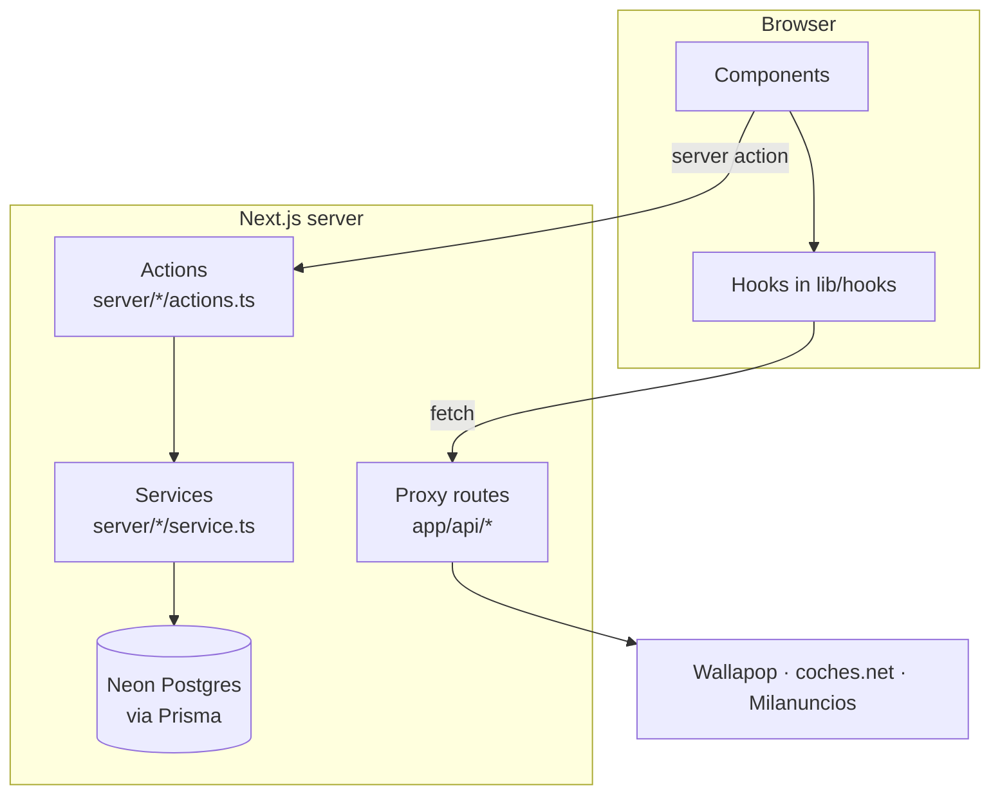
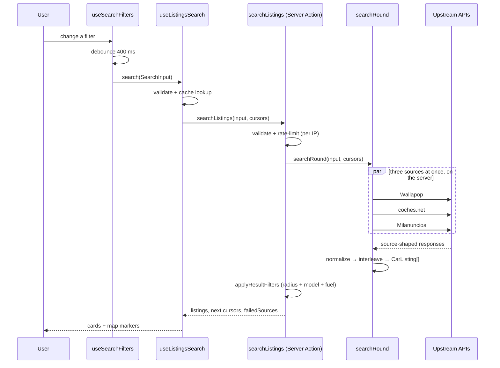
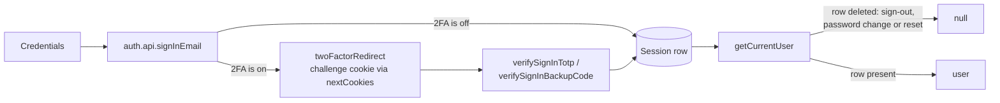
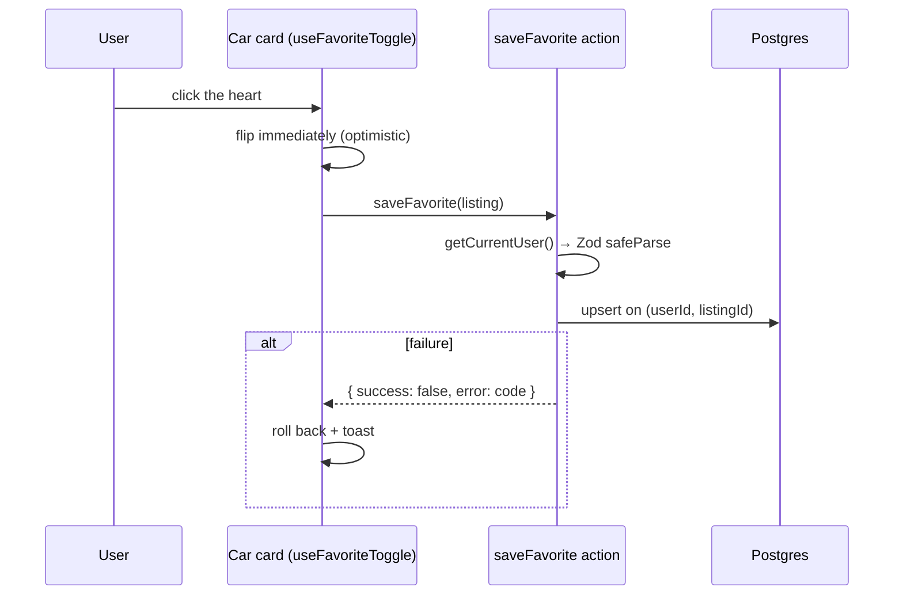
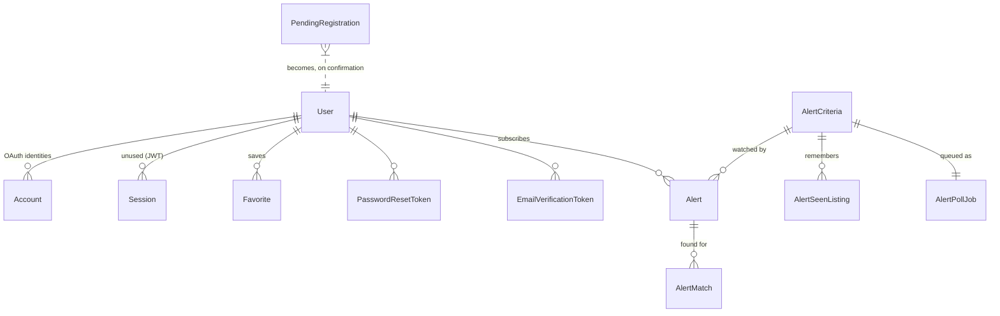
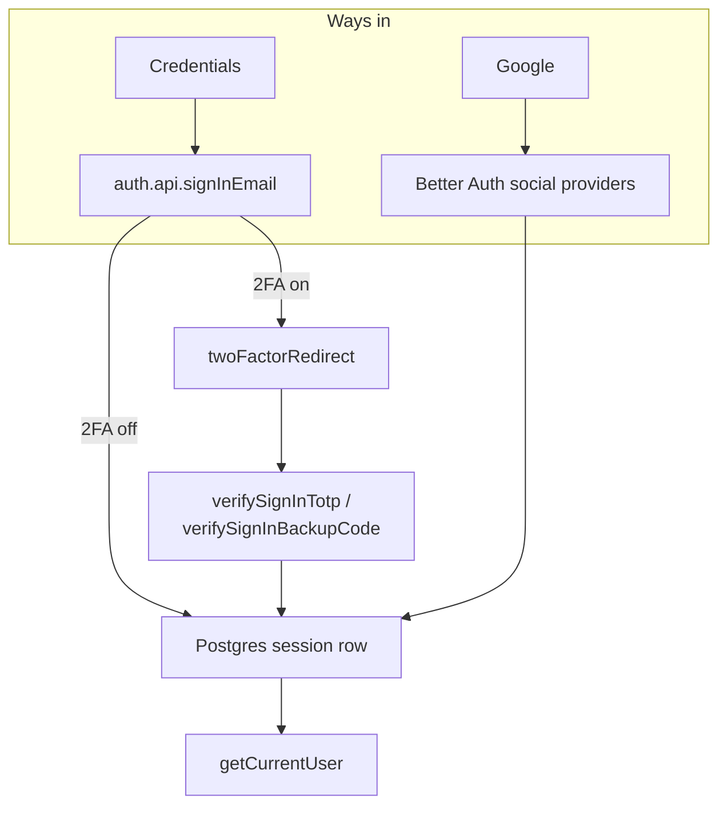

# Architecture

The system in one read: four request paths traced end to end, the patterns that
apply everywhere, then the data model, authentication, the frontend, testing,
and the environments it runs in.

Behaviour guarantees are not here — they live in the specs under
[`specs/`](../README.md#specs) and are enforced by `pnpm spec:check`. This
document explains how the pieces fit, which no single spec owns. Setup and
commands are in the root [README](../README.md#getting-started).

## The shape

A Next.js 16 App Router application. There is no separate backend: server
components, server actions and route handlers all run in the same deployment.



Two rules fall out of that picture and explain most of the code:

- **Components never call `fetch`.** Request lifecycles live in `lib/hooks/*`,
  which call a feature's Server Actions in `server/<feature>/actions.ts` (the
  search, favorites, account and locale hooks) or a cross-cutting helper in
  `lib/<source>/*` or `lib/geo/*`. A component consumes a hook.
- **Mutations are server actions; route handlers are only for proxying.**
  Anything writing to the database is an action in `server/<feature>/actions.ts`,
  which reaches Prisma only through that feature's `service.ts`
  ([specs/core-layout.md](specs/core-layout.md)). The `app/api/` routes exist
  because the upstream marketplaces cannot be called from a browser.

## Path 1 — a search

The core of the product, and the only path that fans out.



ADR 0016: the fan-out is server-only now — `server/search/service.ts`'s
`searchRound` is the one place that calls the three upstreams, shared by the
interactive search (`server/search/actions.ts`) and the alert poller
(`server/alerts/search.ts`). There is no `/api/<source>/` proxy and no
browser-bound `searchWallapop`/`searchCochesNet`/`searchMilanuncios` any more.

**Filters.** [`lib/hooks/useSearchFilters.ts`](../lib/hooks/useSearchFilters.ts)
holds every filter in one `FilterValues` object and exposes a typed setter per
field. Two paths write it:

- `update()` — every desktop popover and filters-panel change — patches state and
  **debounces the search by 400 ms** (MAP-11), so a drag on the price range fires one
  fan-out, not a dozen.
- `apply()` patches and searches at once, with no pause: the phone sheets' «Ver
  coches», a removed chip and the panel's «Borrar» (MAPUI-13, MAPUI-19, MAPUI-21,
  MAPUI-22).

Which desktop popover is open is one piece of state in the hook
(`activePopover`), so at most one is (MAPUI-2). `triggerSearch()` («Buscar»)
searches immediately and closes both the open popover and the filters dropdown;
`update()` closes neither — closing them out from under someone still choosing
would be hostile.

`clearAll()` («Quitar filtros») clears every filter, the criteria the UI no longer
offers included, and **keeps the place and the radius** (MAPUI-31). `setBrand` also
clears `model`: a model only means anything under its brand.

`?q=` survives only in old links; the map still parses it and drops it once a control clears it;
nothing produces it any more (MAPUI-18 in [`specs/redesign-map.md`](specs/redesign-map.md), ENTRY-6
in [`specs/redesign-entry.md`](specs/redesign-entry.md)). It never saves it in an alert (MAPUI-42).

On mount the hook fires an immediate search using the Spain-centre fallback,
starts browser geolocation, and re-searches when geolocation resolves — but only
if the user has not meanwhile picked an explicit location. Doing it in that order
is what stops the first paint waiting on a permission prompt.

**URL state (FRONT-13, ADR 0016).** The filters, the selected location and the
radius live in the URL through [nuqs](https://nuqs.dev) parsers in
[`lib/search/url-state.ts`](../lib/search/url-state.ts) (`searchParsers`,
plus `filtersToUrlState`/`urlStateToFilters` to convert to and from the hook's
`FilterValues`), so a filtered search deep-links and a reload restores it. The
URL is only written at the same points the hook already calls `search()` —
the debounce firing, an explicit `triggerSearch()`, or `apply()` («Ver coches», a removed
chip, «Borrar»; `clearAll()` goes through it) — each as
a pushed history entry, not on every keystroke; a `useEffect` watching the
nuqs-backed state resyncs and re-searches when the URL changes from outside
the hook's own writes (Back/Forward, or a hand-edited URL). The root layout
wraps the app in `nuqs/adapters/next/app`'s `NuqsAdapter`; a component test
that renders a URL-state-backed component uses `nuqs/adapters/testing`'s
`NuqsTestingAdapter` (wired into `renderWithI18n` for component tests, and
per-test via `withNuqsTestingAdapter()` for hook tests that use `renderHook`
directly, e.g. `lib/hooks/useSearchFilters.test.tsx`).

**Fan-out.** [`lib/hooks/useListingsSearch.ts`](../lib/hooks/useListingsSearch.ts)
validates the params with `searchSchema`, checks a 60-second in-memory cache
(`lib/wallapop/cache.ts`, keyed by the JSON-stringified params), then calls the
`searchListings` Server Action once per round — one call, not three fetches.
The Server Action itself (`server/search/actions.ts`) re-validates, rate-limits
per client IP, and calls `server/search/service.ts`'s `searchRound`, which runs
the three upstreams under `Promise.all` and reports each one's next cursor, its
has-more flag and whether it failed.

**Partial failure is the normal case.** Only if *all three* fail does the user
see the inline error state; otherwise the survivors render. Three
reverse-engineered upstreams means one being unavailable is a Tuesday, not an
outage.

Results are merged **round-robin**, not concatenated, so every source appears
near the top instead of whichever returned most dominating the first screen.

**The merge enforces the filters upstream cannot.** Only Wallapop honours the
radius on its side, and only the structured sources honour the model, so the
merged list is post-filtered: with a location chosen, listings outside the
radius — or pinned at the country-centre fallback — are dropped
(`lib/geo/radius.ts`), with a model selected, listings naming it neither
in their model field nor their title are dropped, and with a fuel chosen,
listings whose fuel is unknown or of another fuel group are dropped. The
behaviour is owned by MAP-16..18 in [`specs/map-and-search.md`](specs/map-and-search.md)
and, for the fuel, MAPUI-55 in [`specs/redesign-map.md`](specs/redesign-map.md);
removing the post-filter reverts coches.net and Milanuncios to nationwide results.

**Out-of-order responses.** Every call to `search()` increments
`searchVersionRef`, and the result is discarded if the version moved on while it
was in flight. With a 400 ms debounce and three sources of differing latency, a
slow earlier search would otherwise overwrite a fast later one.

**Pagination is per-source**, because the three APIs page differently: Wallapop
returns a `next_page` cursor, the other two take page numbers with a total —
carried as `SearchCursors` (`server/search/service.ts`) between rounds. The
sentinel calls `loadMore()`, which asks for another round with the cursors the
last one returned; `searchRound` requests the next page only from a source
whose `hasMore` was true. `loadMore` is not part of the hook's public surface —
it fires from an `IntersectionObserver` attached via `sentinelRef`, which is
also how it has to be tested.

Because the post-filter above can empty a page, fetching a page and growing the
list are no longer the same event, and both the first search and `loadMore`
keep fetching rounds until one yields a listing or every source is exhausted.
Removing that loop reintroduces a dead end rather than merely a short page —
the reasoning is MAP-19's, in
[`specs/map-and-search.md`](specs/map-and-search.md).

That loop terminates only because every round advances each source. coches.net
and Milanuncios page by number, incremented server-side, so they advance by
construction; Wallapop's `next_page` cursor is opaque, so `SearchCursors` also
carries `wallapopRequested` — every cursor Wallapop has already been asked for
in this search — and a round that gets the same cursor back, directly or after
a cycle, reports Wallapop exhausted instead of asking for it again. MAP-24, in
[`specs/map-and-search.md`](specs/map-and-search.md).

**One shared filter set drives all three sources.** The UI builds a single
`SearchInput`; each client translates it into that API's parameters. There is no
per-source filter UI, and adding one would be the wrong shape — see
[`specs/data-sources.md`](specs/data-sources.md), whose Contracts section records
what each upstream actually does.

## Path 2 — sign-in and revocation

Better Auth, with sessions stored in Postgres (no cookie cache). The
interesting part is not signing in; it is that signing *out* a session means
deleting the row, so revocation takes effect on the very next request rather
than waiting on a clock.



**`proxy.ts` is UX, not authorization.** It checks only for the session
cookie's presence, with `getSessionCookie` from `better-auth/cookies` — enough
to redirect a signed-out visitor away from `/account` or `/favorites`, but it
cannot see a session that was just revoked. Every server action independently
calls `getCurrentUser()` from
[`lib/auth/session.ts`](../lib/auth/session.ts), which calls
`auth.api.getSession()` and does.

**Never call `getServerSession` directly.** `getCurrentUser()` is the only
authorization check that honours revocation.

**Two-factor runs on Better Auth's own `twoFactor` plugin**
([`lib/auth/auth.ts`](../lib/auth/auth.ts)). Enrolment, confirmation, disabling
and regenerating recovery codes all call its endpoints
([`server/two-factor/actions.ts`](../server/two-factor/actions.ts)); the
sign-in step above does the same
([`server/auth/actions.ts`](../server/auth/actions.ts)'s `verifySignInTotp`
and `verifySignInBackupCode`). The plugin's own state lives in
`users.two_factor_enabled` and the `two_factors` table — see
[specs/core-better-auth.md](specs/core-better-auth.md) › BAUTH-11.

The rest — password policy, enumeration resistance, email flows — is
specified in [`specs/auth-email-and-oauth.md`](specs/auth-email-and-oauth.md);
the orientation is under [Authentication](#authentication) below.

## Path 3 — a favorite

The one path that writes from a user request, and the template for future
mutations.



[`server/favorites/actions.ts`](../server/favorites/actions.ts) is the shape every
server action follows, with its database work in
[`server/favorites/service.ts`](../server/favorites/service.ts):

1. `getCurrentUser()` **first** — before validation, before any query.
2. Zod `safeParse` on the input.
3. Return `{ success, error?: Code }` where the error is a **code**, never prose.
4. Catch and map failures to `unexpected`; never leak the exception.

Three decisions in there worth knowing, each with a reason that is not obvious
from the code:

- **`upsert` with `update: {}`.** Saving is a toggle, so a second click on an
  already-saved listing is an ordinary event rather than an error to recover
  from. The empty update deliberately leaves the original snapshot alone —
  re-saving is not a refresh, and silently rewriting the stored price would make
  staleness harder to reason about, not easier.
- **`removeFavorite` reports success even when nothing matched.** The caller
  asked for the listing not to be saved, and it is not saved. Distinguishing
  "removed" from "was never yours" would confirm that someone else's favorite
  exists.
- **Favorites store a full snapshot, not a reference.** No source client can
  fetch a single listing by id, so a reference-only favorite would have nothing
  to render. The trade-off — the snapshot goes stale — is argued in
  [`specs/favorites.md`](specs/favorites.md).

**Reconciliation.** The sources know nothing about this user, so the saved set is
joined on the client: `useFavorites` fetches the saved ids once per session and
`MapView` hands that set (`favoriteIds`) down to the results and the map, where
each card and preview reads its own saved state from it (`savedProps` in
`components/map/CarCard.tsx`). This was a real bug — cards once rendered without
the saved state, so a saved car came back from a search looking unsaved, while
the component test passed because it supplied a prop the application never did.

## Path 4 — a poll with no user in it

The three paths above all begin with a request. Alerts do not: a GitHub Actions
cron POSTs to `app/api/alerts/run/route.ts`, which authenticates the caller and
hands the run to `server/alerts/service.ts`, which claims work off a Postgres
queue and drains it. Two consequences reshape the rules above rather than
following them.

**It cannot use `lib/*/client.ts`.** Those resolve their URL against
`window.location.origin` and call the proxy routes — which is precisely what the
proxies are for. A cron has neither, so `server/alerts/search.ts` calls the three
upstreams directly with the same headers the proxies send.

**It cannot use `getCurrentUser()`.** The caller is a machine, so the endpoint
authenticates with a shared secret in constant time. This is the one place the
"prefer server actions, route handlers only for proxying" rule does not apply,
because there is no session and no browser to run an action from.

**It applies Path 1's post-filter too.** `server/alerts/search.ts` runs the
same `applyResultFilters` (radius, model and fuel) on what `searchRound` returns,
after counting each source's raw result for `SourceHealth` — a narrow radius
filtering a nationwide page to nothing must not read as the source going
quiet. A filtered-out listing is never recorded as seen and never matches,
on the seed poll as well as every later one; see
[`specs/alerts.md`](specs/alerts.md) › Matches respect the radius and the
model, as the map does.

Everything else it needs — locale for the email, the listing snapshot — is read
from the database, because there is no request context to infer it from. Full
behaviour in [`specs/alerts.md`](specs/alerts.md); the scheduling choice and what
it beat in [`decisions/0006-alert-scheduling.md`](decisions/0006-alert-scheduling.md);
running it in [Alerts](#alerts) below.

## Patterns that apply everywhere

**No data-fetching library.** There is no TanStack Query, SWR or Redux, and
adding one is a decision to raise rather than make. Hooks own their own request
lifecycle, including the out-of-order guard.

**Errors are codes, not messages.** Server code cannot read the client i18n
context and the default locale is Spanish, so actions and Zod schemas return
codes (`AUTH_ERROR`, `FAVORITE_ERROR`). Forms resolve them at render with
`translateAuthError(t, code)` from [`lib/i18n/errors.ts`](../lib/i18n/errors.ts).
When calling `setError`, pass the raw code — the field translates it once.

**Which channel a failure uses follows `STACK.md` §14** (never a toast for a
validation error). Field-level validation is inline and focuses the first
error. Mutation failures elsewhere are toasts (FRONT-15). The sign-in form is
the exception: it shows every failure inline, never a toast (ENTRY-11 to
ENTRY-15, [redesign-entry.md](specs/redesign-entry.md)).

**Configuration is validated at boot.** [`lib/env.ts`](../lib/env.ts) parses
`process.env` with Zod at import time and throws with a readable message. Two
variables are required; everything else disables a feature rather than blocking
startup ([Environment variables](#environment-variables)).

**Everything user-facing goes through `t.*` keys** in both locales. No hardcoded
Spanish or English in components.

## Directory map

| Path | Holds |
| --- | --- |
| `app/` | Routes, layouts, proxy route handlers |
| `server/<feature>/` | The server layer, one folder per feature: `actions.ts` (Server Actions — every mutation), `queries.ts` (page reads), `service.ts` (the only files that import Prisma, apart from `lib/db/` and the LAYOUT-7 exception, `lib/auth/auth.ts` — see [specs/core-layout.md](specs/core-layout.md)), `schema.ts` (Zod schemas with exported inferred types). Boundaries enforced by dependency-cruiser — see [specs/core-layout.md](specs/core-layout.md) |
| `app/api/` | Proxy route handlers for the three upstreams, plus the alert cron endpoint |
| `components/map/` | The search + map feature: `search/` (the desktop pill and its popovers), `filters/` (the filters row and panel), `phone/` (the phone search, sheets and results sheet) |
| `components/alerts/` | The alerts pages' lists and the create-alert dialog |
| `components/nav/` | The headers, the phone tab bar and the language control |
| `components/favorites/` | The saved cars page: the list column, the Guardados card, the phone row and car sheet, the sort chips and the loading placeholders |
| `components/ui/` | Radix-wrapped primitives |
| `components/landing/` | The landing body and its map preview |
| `lib/hooks/` | Every request lifecycle |
| `lib/wallapop/`, `lib/cochesnet/`, `lib/milanuncios/` | One module per source: client, normalize, taxonomy |
| `lib/auth/` | Session, password policy, tokens, two-factor, the redirect guard (`safe-redirect.ts`) |
| `lib/i18n/` | Locale resolution, translations, error-code copy |
| `lib/geo/` | Static cities, Nominatim geocoding, browser geolocation |
| `lib/db/` | The Prisma client module, the only one outside `server/**/service.ts` that reaches the database, apart from the LAYOUT-7 exception, `lib/auth/auth.ts` (see [specs/core-layout.md](specs/core-layout.md)) |
| `lib/favorites/` | The saved cars' pure sort and its URL parser (`sort.ts`) |
| `lib/listings/` | The pure search-merge logic: interleaving, the radius, model and fuel post-filters, the page-state advance |
| `lib/map/` | Pure map helpers: grouping listings into price pins, the results heading, the results state and the radius to widen to (`results-state.ts`), a card's DOM id (`card-dom-id.ts`), price-pin CSS classes (`pin-classes.ts`) |
| `lib/search/` | The `SearchInput` Zod schema every source translates from, until phase 9 moves the search to the server, and the search UI's pure helpers: what the filters panel offers and clears (`panel.ts`), case- and accent-blind comparison (`fold.ts`), the phone summary (`phone-summary.ts`), the radii (`radii.ts`), the type-ahead's matching, the fuel groups, the chips and the alert summary |
| `interfaces/` | Reusable typings — `CarListing`, `SelectedLocation`, `AlertSummary` |
| `scripts/` | Tooling: branch databases, spec, docs and TODO checks — dependency-free except the TODO check, which loads `typescript` |

`app/generated/prisma/` is generated and gitignored.

## Data model

Fifteen models in [`prisma/schema.prisma`](../prisma/schema.prisma), on Neon
Postgres, reached through Prisma 7's `@prisma/adapter-pg` driver adapter. Which
fields hold personal data, and for how long, is in
[`privacy/data-inventory.md`](privacy/data-inventory.md).

One thing is **not** modelled and should not be assumed: normalised `Car`
listing storage. Listings are fetched live on every search and persisted only as
snapshots — on `Favorite` when someone saves one, and on `AlertMatch` when a
poll discovers one.

### Conventions

Every model follows the same conventions, decided in
[`specs/core-data-model.md`](specs/core-data-model.md) and recorded in
[ADR 0015](decisions/0015-data-model-conventions.md):

- **Ids are UUIDv7** (`id String @id @default(uuid(7)) @db.Uuid`), not `cuid()`, so they still sort
  in creation order. Every foreign key is `@db.Uuid` to match — except `Favorite.listingId`,
  `AlertSeenListing.listingId`, `AlertMatch.listingId` and `Account.providerAccountId`, which end in
  `Id` but are not foreign keys into this schema (an external listing id, an OAuth provider's own
  user id) and stay plain `String`.
- **Tables and multi-word columns are snake_case** (`@@map`/`@map`), TypeScript names unchanged —
  `AlertPollJob` → `alert_poll_jobs`, `createdAt` → `created_at`.
- **Every `DateTime` is `@db.Timestamptz(3)`**, not `timestamp` without time zone.
- **Every model carries six standard columns**: `createdAt`, `updatedAt`, `createdById`,
  `updatedById` (nullable FKs to `User`, null for system writes), `deletedAt` and
  `version Int @default(1)`. Unused on a given model (`createdById` on
  a cron-only row), they still exist, for uniformity.
- **Soft delete, not hard delete, for `Favorite` and `Alert`.** Deleting either sets `deletedAt`
  instead of removing the row; every read excludes it through `notDeleted` (`lib/db/soft-delete.ts`).
  Saving over a soft-deleted row restores it (clears `deletedAt`, bumps `version`) rather than
  failing on the unique constraint. `server/retention/service.ts`'s `purgeSoftDeletedRows` erases
  rows **30 days** after `deletedAt`, called from the same opportunistic paths that already prune
  expired auth rows — no new scheduler. Account deletion is unaffected: it still erases at once.
- **Optimistic locking on the two user-editable `User` forms.** `updateProfile` and
  `changePassword` assert the `version` the form rendered and increment it in one `updateMany`; a
  mismatch returns the `conflict` error code instead of silently overwriting a concurrent edit.
- **`onDelete: Cascade` only where the child is meaningless without its parent**, each with a
  one-line comment saying why; every other relation is `Restrict`.

### The models



#### User

The account. Its password is not a `User` field: it is the `password` of the
user's `credential` `Account` row, which OAuth-only accounts do not have
(BAUTH-19, [specs/core-better-auth.md](specs/core-better-auth.md)). "Is the
email verified" is `emailConfirmed`, Better Auth's own flag.

`image`, not `avatarUrl`: the NextAuth Prisma adapter writes the OAuth profile
picture to that exact field name, and renaming it breaks linking silently.

One field is left over from the pre-cutover TOTP implementation:

| Field | Job |
| --- | --- |
| `twoFactorEnabledAt` | Frozen since BAUTH-11 (docs/specs/core-better-auth.md) moved enrolment, sign-in and disabling onto Better Auth's `twoFactor` plugin — its own state lives in `users.two_factor_enabled` and the `two_factors` table instead. Still read by `scripts/notify-2fa-reset.mjs`; kept until a later PR drops it |

Sessions are server-side rows: revoking one deletes the row, and there is no
revocation clock (ADR 0004, superseded).

#### Favorite

A saved listing, stored as a **full snapshot** of `CarListing` rather than a
reference. Fourteen denormalised columns: `source`, `title`, `subtitle`, `image`,
`brand`, `model`, `location`, `fuel`, `url`, `price`, `mileage`, `year`, `lat`,
`lng`.

That looks wrong until you know that no source client can fetch a single listing
by id — all three expose search only — so a `(source, listingId)` row would have
nothing to render. The trade-off, and the alternative it beat, is argued in
[`specs/favorites.md`](specs/favorites.md).

`listingId` is the normalised, source-prefixed id (`wallapop-abc123`), already
unique across sources, so no separate source column is needed as a key.

`@@unique([userId, listingId])` is what makes "saving twice leaves one row" true
**in the database** rather than in a read-then-write race in application code —
the control is a toggle a user can click twice in a second.

#### Auth tokens

Three token tables, all following the same rule: **the raw token is never
stored.** Only a SHA-256 digest, so a database leak does not hand an attacker
working links.

| Model | Backs |
| --- | --- |
| `PasswordResetToken` | `/forgot-password` → `/reset-password?token=` |
| `EmailVerificationToken` | `newEmail == null` confirms the current address; `newEmail != null` moves the account to that address on redemption |
| `PendingRegistration` | A submitted-but-unconfirmed signup |

All are single-use via `usedAt` and expire via `expiresAt`.

**`PendingRegistration` is the one that matters most.** No `User` row exists until
someone proves control of the address, which is what lets the signup form answer
"check your inbox" identically whether or not the email is already taken. It
holds the bcrypt hash, never the plaintext, so confirmation does not have to ask
for the password again.

#### Adapter-required models

`Account` and `Session` exist because
`@next-auth/prisma-adapter` requires them.

**`Session` is dead while the strategy is JWT** — nothing writes to it — but the
adapter's type contract needs the model to exist.

#### The six alert models

Behaviour and reasoning: [`specs/alerts.md`](specs/alerts.md). Each of the six
holds a distinct lifetime and access pattern — a criteria set shared by every
subscriber, a per-user subscription, a per-listing seen-memory, a per-discovery
delivery snapshot, a queue row, and global source health — so collapsing any
pair would conflate concerns with different cascade and retention rules. See
[specs/alerts.md › Data model](specs/alerts.md#data-model).

`AlertCriteria`'s hash of the canonicalised criteria is the property the
upstream request budget depends on. `AlertMatch` stores a full snapshot for the
same reason `Favorite` does: no source client can fetch a single listing by id.

`User.locale` was added alongside these. It exists because the alert runner is a
cron with no request to resolve a locale from, and the default is `es` — without
it every English-speaking user would be mailed in Spanish.

### Cascades

Every user-owned model uses `onDelete: Cascade`, so deleting a `User` removes
their favorites, alerts, tokens, recovery codes and OAuth links.
Deleting an `AlertCriteria` takes its seen-list and queue row with it, which is
what makes releasing an unsubscribed criteria set a single delete. What account
deletion leaves behind is in [`privacy/deletion.md`](privacy/deletion.md).

This is a **schema property enforced by Postgres, not by application code**, and
no Vitest test in this repo can prove it — Prisma is mocked, so a test would only
assert that Prisma was called with the right arguments. It is verified by review
and by the database-backed e2e suite.

### Migrations

Standard Prisma, with one project-specific rule that is not optional.

#### Run `pnpm db:branch` first, from any worktree

`prisma migrate dev` assumes the dev database matches the **current branch's**
migration history. While worktrees share one database, a migration applied from
any one of them makes every other worktree report "applied to the database but
missing from the local migrations directory" — and the only remedy Prisma offers
is a reset that drops every row.

The database holds real accounts and there is no seed script.

**Never run `prisma migrate reset`, `db push --force-reset`, or anything that
drops the database.** Prisma offers it for bookkeeping problems that do not need
it. Treat the offer as a bug report, not an instruction.

`scripts/require-branch-db.mjs` enforces this rather than trusting anyone to
remember — see [Refusing to run](../README.md#refusing-to-run).

#### Two traps

- **`prisma migrate status` does not catch drift.** It reported "Database schema
  is up to date!" against a stale checksum *and* a migration missing locally. It
  validates neither. Only `migrate dev` does.
- **Checksums are SHA-256 of `migration.sql` with CRLF normalised to LF.** On a
  checkout with `core.autocrlf=true` (the Git for Windows default), migration
  files stay CRLF on disk and LF in git, because `.gitattributes` has no rule
  for `prisma/migrations/`. That is **not** a source of drift. Do not chase it.
  The only rule `.gitattributes` does carry is `.husky/* text eol=lf`, which
  keeps the Git hooks LF so knip reads `lint-staged` cleanly.

#### Repairing a stale checksum

```sql
UPDATE _prisma_migrations SET checksum = … WHERE migration_name = …
```

Never a reset. Confirm the file is semantically correct first: if `migrate dev`'s
drift summary shows no differences attributable to that migration, Prisma already
replayed it on a shadow database and it matched.

## Authentication

**This section is deliberately short.**
[`specs/auth-email-and-oauth.md`](specs/auth-email-and-oauth.md) and
[`specs/core-better-auth.md`](specs/core-better-auth.md) cover authentication in
full and are enforced by `spec:check`. Writing a second, unenforced account of
the same system is the most likely way this documentation ends up confidently
wrong.

So: the map, the threat model in a paragraph, and where to read next.

### The pieces

Better Auth (`lib/auth/auth.ts`) replaced NextAuth in phase 11
([0018](decisions/0018-better-auth.md)) for sessions, sign-in and OAuth, with
server-side Postgres sessions instead of a JWT and a revocation clock. The
flows that stay stricter than Better Auth's own defaults — verify-first
registration, the per-account lockout, the fail-closed breach check,
POST-only confirmation links — keep their own server actions, and Better
Auth's own HTTP endpoints for them are disabled (`BAUTH-6`) so a client
cannot reach them around our code.



| Area | Lives in |
| --- | --- |
| Better Auth instance, hooks, providers, the `twoFactor` plugin | `lib/auth/auth.ts` |
| The browser-side client (`authClient`) | `lib/auth/auth-client.ts` |
| Sign-in and its two-factor follow-ups | `server/auth/actions.ts` — `signIn()`, `verifySignInTotp()`, `verifySignInBackupCode()` |
| The only authorization check | `lib/auth/session.ts` — `getCurrentUser()` |
| The one home for ownership checks | `lib/auth/permissions.ts` — `can()`, `ownedBy()` |
| Password rules | `lib/auth/password-policy.ts`, `password-strength.ts`, `pwned.ts` |
| Hashing | `lib/auth/hash.ts` — bcryptjs, 12 rounds |
| Tokens | `lib/auth/tokens.ts` — SHA-256, single-use |
| Two-factor enrolment, disabling, recovery codes | `server/two-factor/actions.ts` — calls the `twoFactor` plugin's own endpoints (`enableTwoFactor`, `verifyTOTP`, `disableTwoFactor`, `generateBackupCodes`) |
| Rate limiting | `server/rate-limit/service.ts` over `lib/platform/rate-limit.ts` — Upstash Redis |
| Route redirects | `proxy.ts` — `getSessionCookie`, a presence check only |
| Email | `emails/` (react-email) sent by `lib/platform/email.ts` — the Resend SDK |

### The threat model in a paragraph

The account is worth taking, so every surface is **enumeration-resistant**:
identical responses whether or not an address exists, bcrypt run *before* any
existence check so timing cannot substitute for the message, and registration
that writes a `PendingRegistration` rather than a `User` until the inbox is
proven. Passwords are gated by length and blocklists rather than composition
rules (NIST SP 800-63B), with the breach check **failing open** so an outage
cannot block signups. Sessions are rows in Postgres, read on every request by
`getCurrentUser()` — revoking one (`signOutEverywhere`, a password change or
reset) ends it on the very next request, not after a JWT revalidation window
(see
[specs/core-better-auth.md › Sessions and sign-in](specs/core-better-auth.md#sessions-and-sign-in)).
Two-factor runs entirely on Better Auth's own `twoFactor` plugin (BAUTH-11):
TOTP secrets and backup codes are encrypted with `BETTER_AUTH_SECRET`, the
same secret every environment already requires, so enrolment needs no key of
its own any more. A TOTP code's own replay window (AUTH-8) is withdrawn as
part of this phase — see [0018](decisions/0018-better-auth.md).

### Rules that are easy to break

The defences a plausible-looking change can quietly remove are listed in
[specs/auth-email-and-oauth.md › Cross-cutting conventions (do not violate)](specs/auth-email-and-oauth.md#cross-cutting-conventions-do-not-violate),
its [Permissions](specs/auth-email-and-oauth.md#permissions) section — a
password reset leaves two-factor enrolment intact (AUTH-11), and an email
change goes to the new address with the current password required to start it
(AUTH-13) — and [specs/core-better-auth.md › Direct endpoint safety](specs/core-better-auth.md#direct-endpoint-safety),
which the disabled Better Auth paths and `can()`/`ownedBy()` ownership checks
depend on.

### Read next

| For | Go to |
| --- | --- |
| Everything: policy, flows, 2FA, OAuth linking, enumeration | [`specs/auth-email-and-oauth.md`](specs/auth-email-and-oauth.md) |
| Better Auth, sessions, the `can()` layer | [`specs/core-better-auth.md`](specs/core-better-auth.md), [0018](decisions/0018-better-auth.md) |
| What the token tables defend against | [Auth tokens](#auth-tokens) |
| Sign-in and revocation as a request path | [Path 2](#path-2--sign-in-and-revocation) |
| Configuring email, OAuth and 2FA | [Environment variables](#environment-variables) |
| Lockouts and undelivered email | [Runbooks](#runbooks) |

## Frontend

The map feature's structure, the navigation, the design system, internationalisation and
theming. Search *behaviour* — the fan-out, debounce and pagination — is
[Path 1](#path-1--a-search) above and specified in
[`specs/map-and-search.md`](specs/map-and-search.md); locale and geography
behaviour in [`specs/cross-cutting.md`](specs/cross-cutting.md); the look in
[`specs/redesign-foundation.md`](specs/redesign-foundation.md).

### The map feature

Everything lives under `/map` and is orchestrated by
[`components/map/MapView.tsx`](../components/map/MapView.tsx), which composes two
hooks — `useListingsSearch()` for results and `useSearchFilters()` for filter
state — and renders the results beside the map on desktop and in a sheet over it on a phone.
What each piece does is specified in [`specs/redesign-map.md`](specs/redesign-map.md) (MAPUI).

```
MapView
├─ HeaderSearch            portalled into MapHeader's centre (lib/hooks/useMapHeaderSlot.ts)
│  └─ SearchPill           «Dónde» · «Coche» · «Precio», then «Crear alerta»
│     ├─ LocationPopover   PlaceField (Nominatim), RadiusChoice, «Toda España»
│     ├─ CarPopover        CarTypeahead: brands, then models through useCarModels
│     ├─ PricePopover      PriceRange (Radix Slider and boxes), shortcuts
│     └─ CreateAlert       the inline card, in the pill's own popover
├─ FilterRow               «Filtros» and the chips; FilterPanel is its desktop dropdown
├─ MapResultsArea          the list-and-map column
│  ├─ PhoneSearchBar       phone only: the summary, the filters button, FilterRow
│  ├─ ResultsSheet         the list column on desktop, the results sheet on a phone
│  │  ├─ CarCard ×n        one link, the heart beside it (CarListingCard wraps it)
│  │  └─ ResultsStatus     placeholders, no results, search error
│  ├─ ListingsMap          dynamic, ssr: false: price pins, MapPreview, MapZoom
│  └─ StatusPill           the desktop map's polite live region
├─ SearchSheet             phone «BUSCAR» (Radix Dialog), applied on «Ver coches»
├─ FilterPanel (phone)     the full-screen filters (Radix Dialog)
└─ CreateAlert (sheet)     the phone create-alert bottom sheet (Radix Dialog)
```

**Layout switches at `lg` in CSS; behaviour reads a media query.** The phone results sheet
slices its cards by position, a phone pin moves the sheet instead of opening the preview, and the
phone map has no zoom control. Those are behaviours, not styles, so
[`lib/hooks/useIsPhone.ts`](../lib/hooks/useIsPhone.ts) tells `MapView` which applies; the
server, and jsdom, take the desktop branch.

**`ListingsMap` is loaded via `next/dynamic` with `ssr: false`.** Leaflet needs
the DOM and will not survive server rendering. It loads the dark CARTO tiles,
draws one price pin per point (`lib/map/group-pins.ts` groups the listings that share one), and
fits bounds via a `FitBounds` child using `useMap()` — on a new search's first results only,
not on every listings change (see `docs/specs/map-and-search.md` › Decisions › The map fits on a
new search, not on a new page (MAP-25)). A pin is a `divIcon` whose HTML carries the theme's
utility classes; its active state is a `data-active` attribute toggled on Leaflet's own element,
because a new icon would make Leaflet replace the element and lose its focus and listeners. The
desktop preview is the marker's Leaflet `Popup`, restyled with important utilities because
`leaflet.css` is unlayered. The map's wrapper is `isolate`, so Leaflet's pane z-indexes stay
below the header's popovers and the results sheet.

Consequences for tests: most component tests mock `react-leaflet`.
`components/map/ListingsMap.preview.test.tsx` is the exception — it renders real Leaflet and
react-leaflet in jsdom for the preview popup's open/close lifecycle, relying on
`test/utils/animations.ts`'s `withAnimations` to turn real exit animations back on for the cases
that need the fade still in flight — see [Environment gotchas](#environment-gotchas).

**The brand list** the type-ahead matches is `components/map/search-filter-options.ts`. The
filter choices and the chip texts come from `lib/search/fuel-groups.ts` and
`lib/search/filter-chips.ts`, whose labels are i18n keys; what the panel offers and what «Borrar»
clears is `lib/search/panel.ts`, shared with the chips and the search hook.

**State lives in hooks.** [`lib/hooks/useMapPageState.ts`](../lib/hooks/useMapPageState.ts) holds
the map page's own UI state (which phone sheet is open, the results sheet's position, the active
pin and card, «Crear alerta»); [`lib/hooks/useCarTypeahead.ts`](../lib/hooks/useCarTypeahead.ts)
the «Coche» type-ahead's query, brand step and choices; `lib/hooks/useOptionNavigation.ts` a
combobox's keyboard and how its list closes (Escape or a press outside, before the popover or sheet
around it). [`lib/hooks/createExternalStore.ts`](../lib/hooks/createExternalStore.ts) shares a value
between parts of the tree with no common parent, such as the root layout's header and tab bar and
the map page; [`lib/hooks/useCurrentPath.ts`](../lib/hooks/useCurrentPath.ts) gives the path and
query a signed-out buyer returns to after signing in.

**One heart everywhere.** [`lib/hooks/useFavoriteToggle.ts`](../lib/hooks/useFavoriteToggle.ts)
owns what pressing a heart does (the session check, the sign-in return with the full path and
query, the optimistic flip and its rollback); `CarListingCard` (alert matches), the map's list,
its preview card and the saved cars page all call it. The sign-in gate itself is
[`lib/hooks/useSignInGate.ts`](../lib/hooks/useSignInGate.ts) — `requireSession(path)`, which
returns `true` when signed in, ignores the press while the session is still loading, and otherwise
redirects to sign in and back to `path` — shared by the heart and «Crear alerta»
(`useMapPageState`).

### The saved cars page

`/favorites` ([`specs/redesign-saved.md`](specs/redesign-saved.md), SAVED) reads the saved cars
once on the server (`listFavoritesForPage`, newest saved first) and hands them to
[`components/favorites/FavoritesList.tsx`](../components/favorites/FavoritesList.tsx), which draws
the list column and, from `lg`, the saved map: the same `ListingsMap`, `groupPins` and
`MapPreview` as `/map`. Below `lg` (`useIsPhone`) the list is compact rows that open the car sheet
(`PhoneBottomSheet`). The composition switches by media query, not by CSS alone, because the
virtualiser needs a row and a column count; until the client has read those queries (the server
render and hydration), the page draws its loading placeholders, whose two compositions CSS picks
between, so a phone never paints the desktop cards first. Besides `useIsPhone`, its state is these
hooks:

- [`lib/hooks/useSavedCars.ts`](../lib/hooks/useSavedCars.ts) — the server's list less the cars
  removed on the page, in the order of the sort in the URL (`sortSaved` and `savedSortParsers` in
  [`lib/favorites/sort.ts`](../lib/favorites/sort.ts); the phone ignores it). Removal and undo go
  through `useFavoriteToggle`, guarded per car against an older answer, and return the failure's
  copy for the page to toast.
- [`lib/hooks/useSavedPins.ts`](../lib/hooks/useSavedPins.ts) — the active pin, tracked by its
  point so a grouped preview survives the removal of its first car, and the cards it outlines.
- [`lib/hooks/useSavedList.ts`](../lib/hooks/useSavedList.ts) — the virtualised list
  (`@tanstack/react-virtual`, [ADR 0021](decisions/0021-react-virtual.md)): rows of cards, a pin's
  row scrolled to, and the first row in view recorded per history entry in `sessionStorage` so
  Back restores it.
- [`lib/hooks/useSavedColumns.ts`](../lib/hooks/useSavedColumns.ts) — how many cards a row holds:
  three from `xl`, two from `lg`, one compact row on the phone.
- [`lib/hooks/useSavedCarSheet.ts`](../lib/hooks/useSavedCarSheet.ts) — the phone's car sheet: the
  car it shows, whether it is open, and the row the focus returns to when it closes.
- [`lib/hooks/useRemovalFocus.ts`](../lib/hooks/useRemovalFocus.ts) — where the focus goes after a
  removal: the neighbour's first control, or the empty state's heading when no car is left.

Its loading and error files draw the same frame
([`components/favorites/SavedLayout.tsx`](../components/favorites/SavedLayout.tsx)) with
placeholders or the page error. Every toast in the app is placed by `app/globals.css` from the
page's `data-toast-anchor` (`saved` here, `map` on `/map`): under the header, or `/map`'s filter
row, and centred over the list column (SAVED-24). A page with no `data-toast-anchor` has its
toast under the header, centred on the viewport.

### UI primitives

`components/ui/` wraps Radix primitives: `button`, `card`, `input`, `label`,
`separator`, plus `toggle-chip` and `checkbox-select`, which have behaviour of their own,
`Headline` (the question-and-punchline headline, used by the landing, `/login` and
`EmptyState`), and the shared states `EmptyState` (the headline, its line and its actions),
`RouteError`, `PageError` (the page-error state, used by the error files of `/map` and `/favorites`) and
`CardGridSkeleton`. The popovers and sheets use Radix Popover and Dialog
directly, and the price range Radix Slider.

**`checkbox-select` is the design's select** (LOOK-21): one style, every option
with a checkbox, several values at once, the trigger listing the chosen values
separated by commas. The Radix select is gone: F3 replaced its uses with the design's controls
(MAPUI-48).

Composition uses `class-variance-authority` with `clsx` and `tailwind-merge`; the
`cn` helper is in `lib/utils.ts`.

**Icons are never raw SVG.** Lucide React for UI icons, React Icons for brand
icons. Size with Tailwind (`h-4 w-4`). Icon-only buttons need a descriptive
`aria-label`.

### Navigation

Specified by [`specs/redesign-navigation.md`](specs/redesign-navigation.md) (HEAD), whose worked
example table is the whole contract of what each page offers; the look is
[HeaderNav](design/system/components/HeaderNav/README.md) and
[BottomNav](design/system/components/BottomNav/README.md). The pieces live in `components/nav/`.

- **One header per kind of page, chosen by route** in
  [`components/nav/SiteHeader.tsx`](../components/nav/SiteHeader.tsx): the map header (`/map`), the
  pages header (`/favorites`, `/alerts`, `/alerts/[id]`, `/account`, and the signed-in landing), the
  landing header (`/` signed out), and the sign-in/legal header (the sign-in, account-recovery and
  legal pages, and every page with no drawn header). Each header's content is fixed rather than one
  bar growing conditionals per page.
- **Desktop and phone regions switch at `lg` in CSS**, not through a media-query hook, which would
  flash on hydration because the server cannot know the viewport. jsdom has no layout engine, so
  what each viewport shows is proved in e2e.
- **No menu and no dropdown** (HEAD-14). Every destination has a home in a header, the tab bar or
  the account page.
- **The language control sits in every header**:
  [`components/nav/LanguageControl.tsx`](../components/nav/LanguageControl.tsx), a group of one
  button per locale (HEAD-10; switching writes the `locale` cookie and calls `setLocale`, see
  [Internationalisation](#internationalisation)).
  The phone map has no header, so it has none.
- **The phone tab bar** ([`components/nav/TabBar.tsx`](../components/nav/TabBar.tsx),
  [`specs/redesign-map.md`](specs/redesign-map.md) MAPUI-52, MAPUI-53) shows at phone width only, on
  the map (signed in or out) and on the signed-in pages, and the signed-in landing (ENTRY-8). It
  runs the full width of the screen,
  padded at the bottom by the safe-area inset; the root layout's viewport opts into the safe area
  with `viewport-fit=cover` (HEAD-17). On the map it hides only while the results sheet is full,
  which `MapView` reports through [`lib/hooks/useResultsSheetFull.ts`](../lib/hooks/useResultsSheetFull.ts);
  scrolling the map or the sheet never hides it. On the other pages it hides while the page scrolls
  down ([`lib/hooks/useHideOnScrollDown.ts`](../lib/hooks/useHideOnScrollDown.ts), which captures
  scroll events from the pages' own scroll containers). Pages keep their last control clear of it with `TAB_BAR_CLEARANCE`
  (HEAD-18, HEAD-19).
- **Sign-out lives on `/account`**,
  [`components/account/SignOutButton.tsx`](../components/account/SignOutButton.tsx) (HEAD-13), not in
  any header.
- **Hiding a link is not authorisation.** The headers read the browser session to decide what to
  offer; `proxy.ts` and `getCurrentUser()` decide who sees a page.

### Design system — BuyCarMap 2.0

The visual source of truth is [`docs/design/`](design/README.md); [`DESIGN.md`](../DESIGN.md)
summarises it for whoever builds a screen, and
[`specs/redesign-foundation.md`](specs/redesign-foundation.md) (LOOK) specifies how the app takes
it. Live references at `/palette` and `/typography`; `/palette` also renders every primitive and is
the e2e harness for their looks (LOOK-9 to LOOK-14), because jsdom does not compute styles from
`globals.css`.

**The tokens in [`app/globals.css`](../app/globals.css) mirror
[`docs/design/system/tokens.json`](design/system/tokens.json)** — every colour, radius and shadow,
with the same name and value, as CSS variables on `:root` (`--bg`, `--surface`, `--lime`,
`--radius-pill`, `--shadow-float`…; LOOK-1). There is no OKLCH value and no second theme block. A
token changes in the design first (`CLAUDE.md` › Design first), then in both files.

**The shadcn utility names are aliases** (LOOK-2), so the classes existing components use
(`bg-card`, `text-muted-foreground`, `border-border`…) take the new palette without an edit; the
design tokens are also exposed under their own names for new code.

| Utility token | Resolves to |
| --- | --- |
| `background` | `bg` |
| `foreground` | `text` |
| `card`, `popover`, `muted`, `secondary`, `accent` | `surface` |
| `border`, `input` | `line` |
| `muted-foreground` | `text-muted` |
| `primary` / `primary-foreground` | `lime` / `on-lime` |
| `destructive` | `danger` |
| `ring` | `lime` |

`accent` maps to `surface`, not `violet`, because it paints hover backgrounds today. The jobs of the
two accents — lime for what you are doing now, violet for what is yours — are in `DESIGN.md` ›
Colors.

#### Typography

Two families, self-hosted as variable `woff2` files committed with their `OFL.txt` licences and
loaded with `next/font/local` in `app/layout.tsx` (FRONT-26, LOOK-6) — not `next/font/google`, so no
build step downloads a font — exposed as CSS variables:

- **Rethink Sans** (`--font-sans`, `app/fonts/rethink-sans/`) — all text
- **Unbounded** (`--font-display`, `app/fonts/unbounded/`) — display type, always uppercase:
  wordmark, headlines, counts and prices

**The type scale is theme tokens too.** `app/globals.css`'s `@theme` exposes `tokens.json` › `type`
with its values unchanged, as `text-<style>` utilities that set the size, and the line height and
letter spacing where the style has them (`text-overline`, `text-section-label`, `text-body-15`,
`text-price`, `text-count`, `text-empty-title`…), plus the phone sizes the styles' notes give
(`text-count-mobile`, `text-empty-title-mobile`) and the sizes the component guides give with no
style of their own (`text-box-label`, `text-tab-label`, `text-pin`, `text-sheet-title`,
`text-empty-line`). The phone tab-bar clearance and the bottom padding of a sheet over it are
spacing tokens (`pb-tab-clearance`, `pb-sheet-bottom`). `lib/utils.ts`'s `cn` knows these names, so
`text-body-15` merges as a font size instead of as a colour.

Each declaration carries a fallback stack (`system-ui, -apple-system, "Segoe UI", sans-serif` for
sans; `"Arial Black", system-ui, sans-serif` for display, as in `tokens.json`), so text stays
readable if a file fails to load. There is no monospace face: `font-mono` is aliased to the sans
family (LOOK-8), so the classes still using it render in Rethink Sans until their phase rewrites
them. Use `font-variant-numeric: tabular-nums` for numbers that are compared down a column.

### Theming

**One dark theme, no toggle.** `<html>` carries a static `class="dark"` with
`color-scheme: dark`, and `<meta name="theme-color">` is `#0F0F10` (LOOK-3). next-themes is removed,
and with it the stored preference: nothing reads or writes a theme in `localStorage`, so a
`theme=light` left by an earlier version is ignored (LOOK-4). The `dark` class stays because the
`dark:` variants in `button.tsx` and `input.tsx` key off it until those primitives are rewritten.

Use the CSS variables (`var(--…)`) for colour rather than branching in JS. The Toaster, the map
tiles and the Google button read the theme as a constant.

Map tiles are the dark CARTO style only,
`https://{s}.basemaps.cartocdn.com/dark_all/{z}/{x}/{y}{r}.png`. It carries `?key=` with
`NEXT_PUBLIC_CARTO_API_KEY` when it is set; without it CARTO serves an "API KEY REQUIRED" watermark
tile instead of the map (MAP-23, [`docs/specs/map-and-search.md`](specs/map-and-search.md)).

### Animation

Motion (`motion/react-client`, with `AnimatePresence` from `motion/react`) rather
than CSS animations for React components.

**Reuse the presets in [`lib/animations.ts`](../lib/animations.ts)** —
`fadeInUp`, `fadeInDown`, `dropdownReveal`, `sheetSlideUp`, `crossFade`, `fadeIn(delay)`
— instead of re-declaring `initial`/`animate` inline.

Animate only `transform` and `opacity`. Never animate layout properties, and
never `transition: all`. Honour `prefers-reduced-motion`.

The app root sets `MotionConfig reducedMotion="user"` in `components/MotionProvider.tsx`,
the client boundary that wraps every page, so this applies everywhere
(FRONT-29, [`docs/specs/core-frontend.md`](specs/core-frontend.md)).

`dropdownReveal` (fade with a 4 px vertical offset in and out, `duration.fast`)
and `crossFade` (fade, `duration.fast`) are the owner-approved presets for
popover content (2026-09-28).

### Internationalisation

Two locales, `en` and `es`, through [next-intl](https://next-intl.dev).
**The default is `es`** — a detail that has caused real bugs, because
hardcoded English strings reach most users. `messages/en.json` is the source
language (ADR 0016); `messages/es.json` mirrors it key for key, enforced by
`messages/messages.test.ts`.

Config in [`lib/i18n/config.ts`](../lib/i18n/config.ts): `LOCALES`,
`DEFAULT_LOCALE`, `COOKIE_NAME = "locale"`.

**No URL prefix.** The locale stays in a cookie rather than a `/en`/`/es`
segment, so no link or bookmark breaks when it changes (ADR 0016).

**Server.** [`i18n/request.ts`](../i18n/request.ts)'s `getRequestConfig`
resolves the locale per request: the `locale` cookie wins; absent, it checks
`Accept-Language` for English and falls back to Spanish otherwise
(`resolveLocale`, a pure function covered directly by
`i18n/request.node.test.ts`, including `docs/specs/cross-cutting.md`
CORE-1..4). It also resolves the time zone from a `tz` cookie — written once
per browser by [`lib/geo/TimeZoneCookie.tsx`](../lib/geo/TimeZoneCookie.tsx)
from `Intl.DateTimeFormat().resolvedOptions().timeZone` — falling back to
`UTC` until that cookie lands. Server components call `getTranslations()`
and `getLocale()` from `next-intl/server`; `app/layout.tsx`'s
`generateMetadata` and the root layout itself both use it.

**Client.** The root layout wraps the app in `NextIntlClientProvider`, fed
the request's locale and messages. Client components call `useTranslations()`
(and `useLocale()` where they need the raw locale string, e.g. for
`lib/format.ts`). [`lib/hooks/useLocaleSwitcher.ts`](../lib/hooks/useLocaleSwitcher.ts)
replaces the old `I18nProvider.setLocale`: it writes the one-year `locale`
cookie directly (next-intl has no client API of its own for changing it) and
`router.refresh()`es inside a transition, so switching language does not
blank the page. It also calls the `setLocale` Server Action so a signed-in
user's stored locale, the one alert emails use, follows the switch
([alerts.md](specs/alerts.md) ALERT-50).

**All user-facing text must use next-intl message keys** (`t("namespace.key")`).
No hardcoded English or Spanish in components. New keys go in both
`messages/en.json` **and** `messages/es.json`; `lib/i18n/types.ts`'s
`Translations` interface describes their shape for code that needs the raw
message tree rather than a translator function (`translateAuthError`,
`translateError` in `lib/i18n/errors.ts` — client components reach it via
`useMessages()`).

Key parity is enforced by `messages/messages.test.ts` (FRONT-8), not the
compiler: a key present in one locale and absent from the other fails that
test by name.

**Alert emails** (`emails/AlertDigestEmail.tsx`) render outside any
request, so there is no `getTranslations()` to call — they use next-intl's
`createTranslator({ locale, messages })` directly, with the recipient's saved
locale and the same JSON message files.

**Tests.** `test/utils/render.tsx`'s `renderWithI18n` wraps components in
`NextIntlClientProvider` with `messages/en.json` and locale `en` by default (plus
nuqs's testing adapter, for components that read or write URL state — see
"URL state" below), so component tests query stable English labels. Copy that a spec's worked
example quotes word for word (in Spanish, the default locale) is asserted with
`renderWithI18n(ui, { locale: "es" })`.

**Pure helpers take their copy.** The map's pure label builders
(`lib/search/filter-chips.ts`, `lib/search/alert-summary.ts`,
`lib/map/group-pins.ts`, `lib/map/results-heading.ts`) take a `copy` argument,
a `LocaleCopy` from [`lib/i18n/copy.ts`](../lib/i18n/copy.ts) — the translator
and the locale — which the calling component builds from `useTranslations()` and
`useLocale()`. The argument is required, with no default, so no caller silently
renders a fixed locale.

Errors reach the UI as codes and are translated at render — see
[Patterns that apply everywhere](#patterns-that-apply-everywhere).

### UI quality bar

The full MUST/SHOULD/NEVER list is in [`RULES.md`](../RULES.md) §19. The ones most
often missed here:

- Visible focus rings; never `outline: none` without a replacement.
- Hit targets ≥24 px, ≥44 px on mobile. Mobile `<input>` font-size ≥16 px.
- URL reflects state — filters, tabs and pagination should be deep-linkable.
- `<a>`/`<Link>` for navigation, never `<div onClick>`.
- Skeletons mirror the final content so nothing shifts.
- Long content needs `truncate`/`line-clamp-*`/`break-words`, and flex children
  need `min-w-0` before they will truncate at all.
- Redundant status cues — never colour alone.

## Testing

**Vitest** (unit, node, integration, component), **React Testing Library**, **MSW** for network,
**Testcontainers** for the real Postgres the integration project runs against, **vitest-axe** for
accessibility, **Playwright** for end-to-end and visual. This is the house setup — do not
introduce Jest or Cypress.

Tests are **colocated**: `foo.ts` → `foo.test.ts`. There are no `__tests__/`
folders.

### The six levels

Choosing the level is a decision made in the spec, not an afterthought. Pushing
work down a level is almost always right.

| Level | Runs in | Named | For |
| --- | --- | --- | --- |
| `unit` | jsdom | `*.test.ts` | Pure library code, source clients (they need `window.location`) |
| `component` | jsdom | `*.test.tsx` | Rendering and interaction, via Testing Library |
| `node` | node | `*.node.test.ts` | Route handlers, server actions, scripts — anything needing real Node request globals, no database |
| `integration` | node, real Postgres | `*.integration.test.ts` | The same, plus anything that reads or writes through `@/lib/db/prisma` |
| `contract` | node | `test/contract/*.contract.test.ts` | The shape of the **external** APIs |
| `e2e` | browser | `e2e/*.spec.ts` | Only what genuinely needs a browser |

#### The three Vitest projects

Split by environment, not by kind — see [`vitest.config.ts`](../vitest.config.ts).

**`unit`** (jsdom) is the default: everything under `lib/`, `components/`,
`app/` and `server/` matching `*.test.{ts,tsx}`.

**`node`** is opt-in **by filename**: `*.node.test.ts`. Route handlers and server
actions need Node's real `Request`/`Response`, which jsdom does not provide. No database — Prisma
is mocked or absent.

**`integration`** is opt-in by filename too: `*.integration.test.ts`, under `app/`, `lib/`,
`server/`, `prisma/` and `test/`. `test/integration.global-setup.ts` starts one
`postgres:17-alpine` **Testcontainers** container per run and migrates a template database once;
`test/setup.integration.ts` gives each Vitest worker its own database copied from that template
(`buycarmap_w<VITEST_POOL_ID>`) and truncates every table under `public` (`_prisma_migrations`
excepted) before each test, so files run in parallel and order never matters
(docs/specs/core-testing.md, TEST-6). `test/factories/*.ts` are faker-based builders — one per
model the tests create — used instead of hand-built rows; they reseed the shared `faker` instance
on every `build*` call, so two builds with the same overrides are equal. Docker Desktop must be
running — see [ADR 0014](decisions/0014-local-database-and-integration-tests.md) for why this
replaced a mocked Prisma client, and why it is a third project rather than folded into `node`.

`pnpm test:unit` runs `unit` and `node` — no database, and what the pre-commit hook runs against
the staged files. `pnpm test:integration` runs `integration` alone, since it is too slow to run on
every commit. `pnpm test` runs all three, with coverage.

Two entries in the `node` include list are worth knowing:

- `proxy.node.test.ts` is listed explicitly, because Next's file convention
  forces `proxy.ts` to sit at the repo root where the `{lib,app,server}/**` glob cannot
  reach it.
- `scripts/**/*.node.test.ts` is covered even though it is not app code — a bug
  in `db-branch.mjs` clobbers real secrets.

### Network: MSW only

**Never hand-stub `global.fetch`.** All network faking goes through MSW, with
`onUnhandledRequest: "error"` so a stray request fails loudly instead of hanging.

| File | Holds |
| --- | --- |
| `test/msw/handlers.ts` | Default happy-path handlers for the three upstream marketplaces (`server/search/service.ts`'s server-side fan-out), Nominatim and the Have I Been Pwned range API |
| `test/msw/server.ts` | The server instance |
| `test/fixtures/*.ts` | Typed builders — `makeWallapopItem`, `makeCochesNetItem`, … |
| `test/mocks/intersection-observer.ts` | Controllable IO; `triggerIntersection()` drives infinite scroll |
| `test/mocks/next-image.tsx` | Stands in for next/image in jsdom tests: `vi.mock("next/image", () => import("@/test/mocks/next-image"))` |
| `test/utils/render.tsx` | `renderWithI18n(ui)`, or `renderWithI18n(ui, { locale: "es" })` for Spanish copy |
| `test/utils/copy.ts` | `ES_COPY` and `EN_COPY`: the real messages of one locale, as the `copy` a pure text helper is given in a test |

Override per-test with `server.use(...)`. Handlers reset in `afterEach`.

**Fixtures: override only the field under test.** A builder that spells out every
field in every test is how a fixture stops describing anything.

**`renderWithI18n` wraps in `NextIntlClientProvider` with `messages/en.json`,
locale `en` and timeZone `UTC`** by default — `{ locale: "es" }` swaps in
`messages/es.json` — (plus nuqs's `NuqsTestingAdapter`, with
`hasMemory` so a component that both reads and writes URL state round-trips
within one test), so tests can query stable English labels. Unlike the
removed hand-rolled `I18nProvider`, `useTranslations()` throws with no
provider in scope at all — there is no silent Spanish fallback — so every
component test that renders a component using it goes through
`renderWithI18n` (or wraps it some other way) rather than a bare
`render(...)`.

### Contract tests

`test/contract/*.contract.test.ts` are Zod schemas of the **external** shapes the
normalizers read — not of our own types.

- `pnpm test:contract` validates the fixtures offline. Runs in CI inside `pnpm check`, on pushes
  to master and on pull requests.
- `pnpm test:contract:live` (`CONTRACT_LIVE=1`) hits the real APIs. **Runs
  nightly**, and is the alarm for an upstream changing shape.

This is the only thing standing between a silent upstream change and a search
that returns nothing. It matters most for Milanuncios, where a layout change
degrades to zero ads rather than an error — see
[the Milanuncios contract](specs/data-sources.md#milanuncios).

### Environment gotchas

Every entry here is a trap someone already fell into. That is what earns them the
space.

**Module-level caches persist across tests.** `lib/wallapop/cache.ts` and
`lib/geo/user-location.ts` hold module state with no reset hook. Use distinct
keys per test, or fake timers.

**Fake timers and `userEvent` do not mix.** Testing Library's async wrapper awaits
a `setTimeout` it only advances when it detects *jest's* fake clock, which Vitest
does not expose — so every interaction hangs until the test times out. Either
drive the hook directly (`renderHook` + `act`), or keep real timers and let
`findBy*` (1 s default) absorb the 400 ms debounce. `LocationPopover.test.tsx`
does the latter.

**Radix Slider and the card scroll need plumbing jsdom lacks.**
`hasPointerCapture`/`setPointerCapture`/`releasePointerCapture` (the price range's thumbs
call them on pointerdown) and `Element.prototype.scrollIntoView` (a pin scrolls its card into
view) are stubbed in `test/setup.jsdom.ts`. Drive the range with the keyboard in jsdom.

**`useListingsSearch.loadMore` is not public.** It fires only from the sentinel.
Test it with `sentinelRef(node)` then `triggerIntersection()`.

**`<input type="email">` uses native browser validation.** A malformed value is
blocked by the browser *before* react-hook-form runs, so RHF's "Invalid email
address" message never renders. Assert "did not submit" for malformed input, and
use empty/required cases to exercise RHF's own messages. The forms deliberately
do not set `noValidate`.

**Controlled inputs need a stateful harness.** A value only accumulates in a controlled input if
a parent holds state. Do not pass a static `value` and expect typing to work.

**jsdom lacks** IntersectionObserver, geolocation (defaults to denied, so the
Spain-centre fallback is what you get), matchMedia and canvas. All are stubbed in
`test/setup.jsdom.ts`.

Motion runs with instant animations in jsdom by default (`test/setup.jsdom.ts`); most tests assert
end states, and animations are exercised by E2E. A test that needs an exit still in flight — a
fading preview card, a closing popover — wraps its own body in `withAnimations`
(`test/utils/animations.ts`), which turns real animations back on for exactly that call.

**Leaflet runs in jsdom for exactly one test file.** Most component tests mock `react-leaflet`;
`components/map/ListingsMap.preview.test.tsx` renders the real library instead, for the preview
popup's open, close and focus lifecycle, which a mock would only repeat rather than prove. jsdom
lays nothing out, so that file asserts no position or size.

### End-to-end

`e2e/`, run against a real `next dev` server via Playwright's `webServer`.
`E2E_PORT` (default 3000) sets the port Playwright starts the app on; neither
`webServer` entry reuses an existing server (FRONT-25), so set it when another
app already listens on 3000.

**Primitive looks are measured on `/palette`** (`e2e/foundation.spec.ts`, LOOK-9 to
LOOK-14). jsdom does not compute styles from `app/globals.css`, so a button's height,
a chip's pressed fill or a focus outline can only be proven in a browser; the style
guide renders every primitive and token in one stable page instead of hunting for each
variant across screens that later phases rebuild.

**Search is mocked by a local upstream server, not `page.route()`**
(FRONT-22, `docs/specs/core-frontend.md`). Search runs through a Server
Action (`server/search/service.ts`), so the request that used to be stubbed
in the browser is now made by the Next dev server itself — `page.route()`
cannot see it. `e2e/fixtures/upstream-server.ts` is a plain `node:http`
server standing in for Wallapop, coches.net and Milanuncios; `lib/env.ts`'s
`WALLAPOP_API_BASE_URL`/`COCHESNET_API_BASE_URL`/`MILANUNCIOS_BASE_URL`
default to the real hosts and are the only thing that points the app at it.
`playwright.config.ts` gives it its own `webServer` array entry (`pnpm exec
tsx e2e/fixtures/upstream-server.ts`) on a fixed port (`E2E_UPSTREAM_PORT`,
default `3912`) — fixed because Playwright starts every `webServer` entry
before running `globalSetup`, so a port `globalSetup` picked itself would
already be too late for the `pnpm dev` entry's env — and points the three
base-URL vars at it.

It serves one of two **scenarios**, switched through its control endpoint
(`POST /__scenario { "scenario": "default" | "empty" }`): `"default"` (one
listing per source) and `"empty"` (every source returns zero listings,
`screenshots.spec.ts`'s "map results list — empty" screenshot). Every spec
but `screenshots.spec.ts` only ever needs `"default"`, which
`e2e/fixtures/network.ts`'s `mockListingSources` sets; `e2e/global-setup.ts`
also resets to `"default"` once the server answers, so every run starts from
`"default"` regardless.
`screenshots.spec.ts` is the only file that ever switches to `"empty"`, and
it runs its own tests serially (`test.describe.configure({ mode: "serial" })`)
with a `afterEach` reset back to `"default"`, since the mock server — like
the one shared `pnpm dev` server — is a single process every worker talks
to. Fixture image URLs must use a host allowed in `next.config.ts`
(`**.wallapop.com`, `**.ccdn.es`) or `next/image` throws a client exception.
`mockListingSources` also stubs `**/_next/image**` (still a real browser
request) — the fixture URLs use allowed hosts but do not exist, so
`next/image` really fetched them, really 404'd, and rendered differently
depending on timing.

Three projects, all run by `pnpm test:e2e`: `chromium` and `mobile` (functional)
plus `visual` (screenshots). `pnpm test:visual` runs the screenshots alone.

#### The database-backed suite

`pnpm test:e2e:db` (`E2E_DB=1`) runs the auth, two-factor, favorites, alert-queue and
toast-theme (FRONT-23) round trips against a real database — the only tests that prove
anything about persistence, since Prisma is mocked everywhere in Vitest. It also runs the saved
cars page (`e2e/saved.spec.ts`, SAVED-3 to SAVED-29), up to 200 saved cars per account. Those are
seeded by a direct insert (`seedFavorites` in `e2e/fixtures/db.ts`) rather than through the UI:
two hundred saves would take minutes, and the order depends on each row's `created_at`, which only
an insert can set.

**The alert-queue tests are the only database-backed ones with no browser in
them.** They drive `FOR UPDATE SKIP LOCKED` through two overlapping `pg`
transactions, because what they assert is what Postgres does when both reach
for the same rows. There is no UI for that, and a Vitest fake would supply the
exclusivity and the ordering itself — proving the fake. They live here because
this is where a real database is. See [`specs/alerts.md`](specs/alerts.md).

**It needs `pnpm db:branch` first.** Without its own branch database it writes to
whatever `DATABASE_URL` points at. Global teardown deletes every `@e2e.local`
account, and `Favorite` rows go with them by cascade; the alert helpers clear
their own queue rows before and after each run.

**Env-prefixed scripts need `cross-env`.** `E2E_DB=1 playwright test` is POSIX
syntax that cmd.exe does not understand, so on Windows the script failed with
`'E2E_DB' is not recognized` and the suite never ran at all. CI is ubuntu, where
the bare form works, so nothing caught it — the gate was broken on the only
machine that runs it. Both `test:e2e:db` and `test:contract:live` now go through
`cross-env`; any new script that sets a variable inline must do the same.

**It is not in CI.** `pnpm test:e2e` runs without `E2E_DB`, so those tests skip
there and gate nothing. Wiring them needs `NEON_API_KEY` as a GitHub secret plus
a job that forks and deletes a branch database per run. Until that exists, **a
green CI says nothing about persistence.**

Two traps found while wiring it up:

- **The suite exhausts its own login rate limit.** Dozens of sign-ins from one
  address against a limit of 20 per IP per 15 minutes, so a second run inside
  that window failed every test with what looked like broken auth. That limit no longer applies in e2e:
  `playwright.config.ts` blanks the Upstash variables (INT-5), so the limiter
  allows every request.
- **`webServer.env` merges with `process.env`**, and `playwright.config.ts` loads
  `.env` at line 1. Registration behaves completely differently depending on
  whether email is configured, so the mode was decided by the developer's `.env`
  until `RESEND_API_KEY`/`EMAIL_FROM` were pinned to `""` there.

**On a server-rendered page, wait for the session before clicking.** `/favorites`
paints its cards from the server, so they are clickable well before
`useSession()` resolves — and a favorite click while the session is loading is
deliberately ignored (FAV-18). Clicking too early is therefore a silent no-op,
which surfaced as `FAV-3` failing two runs in three. `waitForSession()` waits for
the header to swap in the signed-in controls, the same hydration signal
`waitForPageToSettle` uses. `/map` hides this window because its cards only exist
after the source fetches resolve.

This one was worth chasing rather than retrying: the same early click used to
push a signed-in user to `/login`, which `proxy.ts` bounced to `/`. The flake was
a real bug wearing a timing costume.

**Never assert an optimistic UI toggle to prove a write landed.** The favorite
control flips before the server answers and rolls back after a failure, so the
assertion passes even when nothing was saved — and navigating away next cancels
the request. `e2e/favorites.spec.ts` polls the row count in Postgres instead.

#### Visual tests

**Baselines are platform-specific** (`*-win32.png` locally; CI is ubuntu). Each
visual test **skips itself with an explanatory reason** when the current platform
has no baseline, so a Linux CI stays green until Linux baselines are committed.
Generate them with `pnpm test:visual --update-snapshots` on that platform: under
that flag the tests run instead of skipping, and write the missing files
([TEST-15](specs/core-testing.md)). Commit a new baseline only after the owner
has reviewed the image. The skip rule is a pure function tested without a
browser in `e2e/visual-baseline.spec.ts`, which runs in the `chromium` project
and so in CI, where the visual tests themselves skip until Linux baselines are
committed.

**The login and map baselines were regenerated for BuyCarMap 2.0** (owner-approved,
`docs/specs/redesign-foundation.md` › Decisions › Visual baselines and docs move with the
look): a baseline of the old look would only prove the old look. A later phase that
changes a screen regenerates its baseline the same way, after the owner reviews it.

**Screenshots must wait for the page to settle** (`waitForPageToSettle` in
`e2e/visual.spec.ts`). The header swaps a placeholder for real links when
`useSession()` resolves, and `next/font` loads asynchronously. Both raced the
camera and made these tests look inherently flaky. They are not.

**`maxDiffPixels: 300` is calibrated, not arbitrary**: roughly 86 px of
antialiasing noise between identical renders, versus 1,310 px for a one-step
font-size change. Do not raise it to silence a failure — read the diff PNG in
`test-results/`, which points straight at the culprit.

### Coverage

A **ratchet, not a target**: 89 statements / 85 branches / 84 functions / 89
lines, each set a point under what was measured so ordinary variance does not
fail CI but a real drop does.

Raise them when coverage rises. **Never lower them to make a red build green.**

Route shells (`app/**/page.tsx`, `layout.tsx`) are deliberately still counted even
though Playwright is what exercises them — excluding them would flatter the
number and hide logic that drifts into a page. `scripts/` is outside the coverage
scope entirely.

### Quality bar

The `/check-tests` rules are the real gate, and they apply to every test written
here:

- No tautological assertions, no self-fulfilling fixtures, no mocking the unit
  under test.
- **Hand-derive every expected value.** Computing the expectation the same way
  the code does proves nothing.
- Cover a negative path. Invalid input, empty result, upstream failure,
  unauthorised caller — that is where the bugs are.
- When a test is red, **fix the production code, not the test** — when an
  existing test may change is in [the spec workflow](../README.md#contributing).

`pnpm spec:check` proves an acceptance criterion is *mentioned* by a test title.
It cannot prove the assertion behind it is meaningful. Only review does.

### Known findings, unfixed

Surfaced by the suite and deliberately left:

- Auth pages fail `color-contrast`, and are excluded from the a11y gate.
- Malformed email is caught by native browser validation rather than
  react-hook-form, because the forms lack `noValidate`.

## Environments and operations

Deploying, configuring and fixing this in production. Production runs on one Neon project,
`buycarmap`, whose `main` branch is production, served at https://buycarmap.vercel.app. There is
no staging environment ([ADR 0019](decisions/0019-environments.md)): three environments exist —

- **Production** — Vercel's Production target, Neon's `main` branch.
- **Preview** — every Vercel preview deployment (one per open PR) shares one long-lived Neon
  branch, the `preview` Neon branch, created schema-less or from an empty parent — never a child
  of production, so no preview ever reads or writes production data. It carries seed data only
  (`pnpm db:seed` with `SEED_TARGET_HOST` set to it, below), migrated by the same
  `scripts/migrate-deploy.mjs` step as production (ENV-3). `BETTER_AUTH_URL` is not set for the
  Preview target, so `resolveAppUrl` (`lib/app-config.ts`) falls back to each deployment's own
  `VERCEL_URL` instead of production's.
- **Local** — Docker Compose Postgres, one database per git branch — see
  [Local database](#local-database).

**Local development and CI no longer touch Neon at all** for their own databases. Both run against
Docker Compose Postgres instead — see [Local database](#local-database) — which is what
[ADR 0014](decisions/0014-local-database-and-integration-tests.md) records and why. Migrations are
rehearsed against Neon before they reach `preview` or production: create a temporary branch off
`main` in the Neon console (auto-delete after a day), point `DATABASE_URL`/`DIRECT_URL` at it, and
run `prisma migrate deploy` — the same procedure phase 11 used for the Better Auth migration,
recorded for reuse rather than re-invented per migration.

### Recovering a drifted `preview` branch

Two open PRs with conflicting migrations (or a migration whose PR was abandoned after it ran) can
leave the shared `preview` branch's schema inconsistent with `main`'s migration history
(`docs/specs/core-environments.md` › Edge cases). The fix is to recreate it, not to reconcile it by
hand:

1. The owner deletes the `preview` branch in the Neon console and recreates it schema-only from
   `main` (or as an empty branch) — this is a manual step, never automated against Neon.
2. Mark every migration already in `main`'s history as applied, without re-running them:
   `pnpm exec prisma migrate resolve --applied <migration-name>`, once per migration folder under
   `prisma/migrations/`, in order.
3. Seed it: `SEED_TARGET_HOST=<the branch's hostname> pnpm db:seed`, with `DATABASE_URL` pointed at
   the branch — `assertSeedTarget` (`prisma/seed.ts`, ENV-4) refuses any non-local host whose
   hostname `SEED_TARGET_HOST` does not name exactly, so this is the one deliberate exception to
   the local-only guard the other worktree scripts enforce.

### Local database

`docker-compose.yml` runs one `postgres:17-alpine` service, published on `localhost:5433` (not
5432, so it never collides with a Postgres already running there), with a named volume so branch
databases survive a restart. Its Compose project name is fixed to `buycarmap`, so the main
checkout and every git worktree resolve to the same project instead of Compose naming each
checkout's project after its directory — one container, one port, one volume shared by all of them
(TEST-16).

```bash
pnpm db:up            # start it — Docker Desktop must be running
pnpm db:down          # stop it, keeping the volume
pnpm db:branch        # this git branch gets its own database inside it, and DATABASE_URL is
                       # written to this worktree's .env
pnpm db:branch:rm     # delete it once the work is merged
pnpm db:seed          # fill an empty database with development data
```

`scripts/db-branch.mjs` derives the database name from the git branch — `buycarmap_` plus the
branch name, lowercased, every character outside `a-z0-9` replaced with `_`, runs collapsed, cut to
Postgres' 63-byte limit with a hash suffix when needed (docs/specs/core-testing.md, TEST-2) — talks
to Postgres through `docker compose exec … psql`, so it stays dependency-free like
`require-branch-db.mjs`, and then runs `prisma migrate deploy` against it. Both scripts refuse to
touch anything but `localhost`/`127.0.0.1` (TEST-3), so a worktree can never reach Neon, and so
production, by accident.

`pnpm db:seed` (`prisma/seed.ts`, wired through `prisma.config.ts`'s `migrations.seed`) fills an
empty database with three accounts sharing the password `buycarmap-dev-1` (one with two-factor
on, its TOTP secret printed to the console), ten favorites and three alerts with matches. It is
idempotent — rerunning it on an already-seeded database changes nothing — and refuses to run
against anything but a local database, the same way `db-branch.mjs` does, unless `SEED_TARGET_HOST`
names the exact hostname of a deliberate exception — the shared `preview` Neon branch, never
production (ENV-4, `assertSeedTarget`). It is never run in CI or the Vercel build.

The same container image and per-worker-database pattern back the `integration` Vitest project —
see [Testing](#testing) — through `@testcontainers/postgresql` instead of Compose, so integration
tests need no `pnpm db:up` first.

### Deployment

Vercel. [`vercel.json`](../vercel.json) pins every function to the `fra1` (Frankfurt) region, next
to Neon's `aws-eu-central-1` — before this, functions ran wherever Vercel scheduled them, and the
Preview target had no region configured at all (ENV-2, [ADR 0019](decisions/0019-environments.md)).

`pnpm build` runs `prisma generate && node scripts/migrate-deploy.mjs
&& next build`. The migration step runs `prisma migrate deploy` when
`VERCEL_ENV` is `production` or `preview` — previews have their own seed-only
Neon branch, the `preview` Neon branch, since phase 12, so migrating from a
preview build no longer touches production (ENV-3). Everywhere else it
prints one line and exits `0`; see [ADR 0013](decisions/0013-platform-runtime.md)
and [ADR 0019](decisions/0019-environments.md).

`GET /api/health` answers `200 {"status":"ok"}` without touching the
database. `GET /api/health/db` runs one `SELECT 1`
(`server/health/service.ts`) and answers `503 {"status":"error","db":"unreachable"}`
when it fails. Both send `Cache-Control: no-store` and carry no personal
data.

#### Security headers

`X-Frame-Options: DENY`, `X-Content-Type-Options: nosniff`,
`Referrer-Policy: strict-origin-when-cross-origin`, a `Permissions-Policy` and
two-year HSTS with preload are set in [`next.config.ts`](../next.config.ts)
for every route.

**`Content-Security-Policy` is built per request in [`proxy.ts`](../proxy.ts)**,
not `next.config.ts`. `script-src` carries a fresh base64 **nonce** of at
least 128 bits on every response — `'self' 'nonce-<n>' 'strict-dynamic'`, plus
`'unsafe-eval'` in development — with no `'unsafe-inline'`. The nonce no
longer feeds a theme script: next-themes and its inline bootstrap script are
gone with the single dark theme, and the CSP keeps working for the map, login
and favorites (PLAT-23, amended by LOOK). The high-value directives are otherwise unchanged: `frame-ancestors`,
`object-src`, `base-uri` and `form-action` are what block clickjacking, plugin
injection and form exfiltration.

**A fresh nonce per response means every page renders dynamically** — no
full-route cache, one proxy run per request. [ADR 0013](decisions/0013-platform-runtime.md)
records the trade and what it cost the build's static page count.

Two hosts are allowed, and both trace to a real browser-side dependency:
`*.basemaps.cartocdn.com` for map tiles (`img-src`) and
`nominatim.openstreetmap.org` for geocoding (`connect-src`). Listing photos are
*not* listed because `next/image` proxies them through `/_next/image` on this
origin. Sentry's browser events go through the `/monitoring` tunnel route
instead of `*.sentry.io`, so the CSP needs no Sentry host.

`geolocation=(self)` must stay — the map asks for the user's position.

#### Logging and error monitoring

[`lib/logger.ts`](../lib/logger.ts) is the one Pino logger: JSON in
production, `pino-pretty` in development, silent under Vitest. Its `redact`
paths censor `password`, `token`, `email`, `secret`, `code`,
`headers.authorization` and `headers.cookie` at the top level and one level
deep. Every `console.*` call in `app/`, `components/`, `lib/`
and `server/` was replaced by it (Biome's `noConsole` is an error for those
paths; `scripts/**` and `e2e/**` are exempt).

Every request proxy.ts handles gets an `x-request-id` — a valid incoming one
is kept, otherwise a fresh UUID is generated — forwarded to the app and
returned on the response. [`lib/request-context.ts`](../lib/request-context.ts)
holds it in a Node `AsyncLocalStorage`; every converted Server Action and
route handler runs inside it (`withRequestContext`), so every log line
written while handling that request carries a matching `requestId`, and every
Sentry event carries the same value as a `request_id` tag.

[`lib/sentry.ts`](../lib/sentry.ts) and `instrumentation.ts` initialise
`@sentry/nextjs` only when `SENTRY_DSN` is set — inert otherwise, nothing is
sent. `dataCollection` (`lib/sentry-privacy.ts`) turns off user identity, cookies, headers, request bodies and query strings, query data and stack-frame variables, `tracesSampleRate: 0`, no session replay.
Source maps upload only when `SENTRY_AUTH_TOKEN` is set. See
[`privacy/processors.md`](privacy/processors.md) for what it receives.

#### Image hosts

`next.config.ts` allows `**.wallapop.com`, `**.ccdn.es`, `**.milanuncios.com` and
`images.unsplash.com`. **A new source needs its CDN added here**, or `next/image`
throws at runtime rather than degrading.

### Environment variables

[`lib/env.ts`](../lib/env.ts) is built on **`@t3-oss/env-nextjs`**'s
`createEnv`, validated at import, which throws at boot naming every invalid or
missing variable rather than failing later. It is Edge-safe (no `dotenv`, no
`node:*` import), so `proxy.ts` can import it too — though today it only
calls `isDevelopmentRuntime()` from there; routing decisions come from the
Better Auth session cookie (`getSessionCookie`), not from reading
`BETTER_AUTH_URL` or `BETTER_AUTH_SECRET` directly. No other file under `app/`, `components/`,
`lib/` or `server/` reads `process.env` directly. `SKIP_ENV_VALIDATION=1`
skips validation entirely — only `pnpm lint` (through `cross-env`) and CI's
lint job set it. The flags and URLs derived from these variables
(`isEmailConfigured`, `isTwoFactorConfigured`, `isGoogleConfigured`,
`appUrl`) live in [`lib/app-config.ts`](../lib/app-config.ts)
instead, server-only, so the client bundle can import `lib/env.ts` for
`NEXT_PUBLIC_*` without touching server-only fields.

Required:

| Variable | Notes |
| --- | --- |
| `DATABASE_URL` | Neon connection string. `lib/db/prisma.ts` builds the client with **`PrismaNeon`** over this (pooled) URL when `VERCEL` is set — every Vercel deployment — and with `PrismaPg` otherwise |
| `BETTER_AUTH_SECRET` | Signs every session. `openssl rand -base64 32`. Under 32 chars logs a warning. **Rotating it signs everyone out.** In Vercel, set it to the *current* `NEXTAUTH_SECRET` value rather than a new one — the alert unsubscribe HMAC keys on it, and a new secret would stop already-sent links matching their stored hash ([ADR 0018](decisions/0018-better-auth.md)) |

Optional — each disables a feature rather than blocking startup:

| Variable | Absent means |
| --- | --- |
| `BETTER_AUTH_URL` | Also decides `useSecureCookies`. Must be `https://` in production or session cookies ship without the Secure flag |
| `RESEND_API_KEY` + `EMAIL_FROM` | Mailer no-ops, so password-reset links are never delivered. Registration falls back to immediate account creation, **which leaks whether an address is registered** |
| `APP_URL` | Falls back to `BETTER_AUTH_URL` → `https://$VERCEL_URL` → `http://localhost:3000`. Only set it when the canonical domain differs from `BETTER_AUTH_URL` |
| `GOOGLE_CLIENT_ID` + `GOOGLE_CLIENT_SECRET` | Google button does not render. Both halves of the pair are required. Google is the only social sign-in the product offers (docs/specs/redesign-entry.md, ENTRY-16, ENTRY-18) |
| `UPSTASH_REDIS_REST_URL` + `UPSTASH_REDIS_REST_TOKEN` | `lib/platform/rate-limit.ts` disables rate limiting — every request is allowed and one warning is logged per process. Required when `VERCEL_ENV` is `production` or `preview`; the build fails without them there |
| `QSTASH_TOKEN` | `scripts/qstash-schedule.mjs` refuses to run |
| `QSTASH_CURRENT_SIGNING_KEY` + `QSTASH_NEXT_SIGNING_KEY` | The alert run endpoint refuses every request (no valid `Upstash-Signature` can ever verify), so alerts never fire |
| `DIRECT_URL` | Prisma's migration commands (`prisma.config.ts`) use `DATABASE_URL` instead — fine locally, but that must be an unpooled connection on Vercel, where `DATABASE_URL` is the pooled (`-pooler`) host |
| `SENTRY_DSN`, `NEXT_PUBLIC_SENTRY_DSN` | Sentry stays uninitialised; nothing is sent |
| `NEXT_PUBLIC_CARTO_API_KEY` | Map tiles show CARTO's "API KEY REQUIRED" watermark instead of the map |
| `SENTRY_AUTH_TOKEN`, `SENTRY_ORG`, `SENTRY_PROJECT` | Sentry build-time source-map upload is skipped |
| `SKIP_ENV_VALIDATION` | Tooling only — see above. Never set for `pnpm dev`/`build`/`start` |
| `LOCAL_DATABASE_ADMIN_URL` | Tooling only, never read by the app. Overrides the admin connection `pnpm db:branch` uses to create and drop databases in the local Compose Postgres; the default matches `docker-compose.yml` |

`VERCEL`, `VERCEL_ENV` and `VERCEL_URL` are injected by Vercel itself and are
never set by hand. `.env.example` carries the reasoning next to each entry.

**On Vercel previews, leave `APP_URL` unset** so the `VERCEL_URL` fallback makes
each deployment link to itself rather than to production.

### Restoring production

Restoring production from Neon's point-in-time history is a separate procedure:
[`operations/backups.md`](operations/backups.md). It is the only thing that still reaches the
Neon project directly from a runbook — everything else in this section runs locally; see
[Local database](#local-database).

### CI

[`.github/workflows/test.yml`](../.github/workflows/test.yml).

| Job | Runs on | Does |
| --- | --- | --- |
| `check` | push to master, pull requests | `prisma generate` → `pnpm check`: lint → typecheck → test → build |
| `gitleaks` | push to master, pull requests | gitleaks over the pushed commits |
| `e2e` | pull requests only | `prisma generate` → Playwright, chromium, no retries; uploads the report as an artifact |
| `contract-live` | nightly cron (04:00 UTC) | `test:contract:live` against the real upstream APIs |
| `Preview smoke` ([`e2e-preview.yml`](../.github/workflows/e2e-preview.yml)) | Vercel's `deployment_status` event, state `success`, environment `Preview` | Playwright, `e2e/preview-smoke.spec.ts` only, against `environment_url` with the Deployment Protection bypass header; uploads the report on failure |

[`.github/workflows/pr-title.yml`](../.github/workflows/pr-title.yml) checks that the pull request
title is a Conventional Commit — it becomes the squash commit on master.
[`.github/workflows/release-please.yml`](../.github/workflows/release-please.yml) opens and updates
the release PR on every push to master; merging it tags the release and writes `CHANGELOG.md`,
which is never edited by hand. Renovate (`renovate.json`) proposes dependency updates: minor and
patch bumps are grouped into one PR a week (Monday morning, Europe/Madrid), a PR rebases itself
when it falls behind master instead of going stale, and a vulnerability alert can open a PR at any
time rather than waiting for the weekly schedule.

`pnpm check` stops at the first failing stage, and its static checks come first because they fail
in seconds. `prisma generate` runs before it because `typecheck` and the tests import the
generated client.

CI env vars are dummies — nothing connects to a real database or signs a real
token. The secret is padded past 32 characters only to keep the length warning
out of the logs.

**`pnpm test:e2e:db` is not in CI.** See
[The database-backed suite](#the-database-backed-suite).

**Branch protection on `master`**: the policy is [specs/core-tooling.md](specs/core-tooling.md) › Decisions and rationale.
The required checks are `Check`, `Secrets (gitleaks)`, `End-to-end (Playwright)`, `Conventional
Commits title` and, since ENV-6, `Preview smoke` — required even though it only ever reports once
Vercel's preview deployment exists, so a deployment that never happens leaves the PR blocked rather
than silently passing (`docs/specs/core-environments.md` › Edge cases). `.github/CODEOWNERS`
requests the owner's review on every pull request, and `.github/pull_request_template.md` is the
description `/check-pr` fills in.

### Rate limiting

**Upstash Redis**, through `lib/platform/rate-limit.ts` — the only module that
imports `@upstash/ratelimit` or `@upstash/redis`
([ADR 0017](decisions/0017-upstash-qstash-react-email.md); supersedes
[ADR 0005](decisions/0005-postgres-rate-limiting.md)'s Postgres table). `server/rate-limit/service.ts`
keeps its own public API (`consumeRateLimit`, `isRateLimited`,
`resetRateLimit`, `RATE_LIMITS`) and calls the adapter instead of Prisma.

A sliding window per rule, built with `Ratelimit.slidingWindow(limit,
"<windowMs> ms")`. Every key carries an environment prefix —
`production:`/`preview:`/`development:`, from `VERCEL_ENV` — so a preview
deployment and an e2e run never consume production's budget. An
`:email:<value>` segment is replaced with the sha256 hex of the lowercased
address before it ever reaches Redis (`docs/privacy/processors.md`); an IP
segment is sent as-is, because a per-IP limit needs the IP. On any Redis
error, `consume`/`peek` fail open — the same behaviour the Postgres version
had — and log a `warn` naming the rule, never the key.

**No local Redis.** `@upstash/ratelimit`'s Lua scripts carry a Redis flag
that is an Upstash-only extension, which a real local Redis rejects outright
([ADR 0017](decisions/0017-upstash-qstash-react-email.md)). Without
`UPSTASH_REDIS_REST_URL`/`UPSTASH_REDIS_REST_TOKEN`, `consume`/`peek` allow
every request and `reset` no-ops, logging one `warn` per process rather than
reaching a Redis that was never going to run the real algorithm anyway —
local development, e2e and the integration tests all run with neither
variable set. `lib/env.ts` requires both when `VERCEL_ENV` is `production`
or `preview`, so a deploy without them fails the build instead of shipping
with rate limiting silently off.

`consume`/`peek`/`reset` take an optional `redis`/`limiterFactory` pair (the
real `Ratelimit` by default), so `server/rate-limit/service.integration.test.ts`
can inject an in-memory sliding-window fake (`test/fakes/ratelimit.ts`) and
exercise the real limiting math — remaining budget, retry wait, reset —
without reaching any Redis at all.

### Background work (alerts)

Saved searches are drained by a **QStash schedule** calling `POST
/api/alerts/run` every five minutes (`*/5 * * * *`, 3 retries) — set up once
with `pnpm qstash:schedule` (`scripts/qstash-schedule.mjs`) after the owner's
QStash variables are in Vercel. Why QStash rather than the GitHub Actions
cron this replaced: [`decisions/0006-alert-scheduling.md`](decisions/0006-alert-scheduling.md)
(superseded by [ADR 0017](decisions/0017-upstash-qstash-react-email.md)).
Behaviour: [`specs/alerts.md`](specs/alerts.md).

**The route trusts only QStash's own signature**, verified by
`lib/platform/qstash.ts`'s `verifyQstashSignature` (`@upstash/qstash`'s
`Receiver`) against the `Upstash-Signature` header and
`QSTASH_CURRENT_SIGNING_KEY`/`QSTASH_NEXT_SIGNING_KEY` — accepting both lets a
key rotation in the Upstash console skip a deploy. An unsigned or wrongly
signed request gets `401` and nothing runs.

**Post-response housekeeping — the opportunistic auth-token prune and the
DATA-12 soft-delete purge — runs inside `after()`** from `next/server`
(`server/auth/service.ts`'s `maybePruneExpiredAuthRows`), so it never delays
the response that happened to trigger it. A failure inside that callback is
logged and reported to Sentry, never thrown. Calling `after()` outside a
request scope (a script, or a test calling the function directly) throws, so
`maybePruneExpiredAuthRows` falls back to running the housekeeping inline in
that case rather than losing it.

**The run's response is the instrument.** Read it before anything else:

| Field | Means |
| --- | --- |
| `intervalMs` | The cadence in force. Above 300000 the criteria count has pushed past the request ceiling and every alert is being polled less often |
| `oldestPendingAgeMs` | How stale the worst-off criteria set is. The freshness target is ten minutes end to end; sustained values above that mean the lap is not keeping up |
| `unhealthySources` | Sources returning nothing for three consecutive runs — the silent-death signal |
| `skippedNoEmail` | Matches found but not sent, because the mailer is unconfigured |
| `failures` | Per-criteria poll errors, with the upstream message |

**Scheduled runs can still drift.** QStash retries and delivers on schedule far
more reliably than GitHub's best-effort cron did, but judge health by
`oldestPendingAgeMs`, not by wall-clock spacing between runs.

**The first deploy, before the schedule exists.** Alerts pause until the owner
runs `pnpm qstash:schedule` against the deployment. The queue keeps its jobs
and drains on the first run once the schedule is created.

#### Alerts stopped arriving

1. Check the schedule exists and is active in the Upstash console (QStash →
   Schedules), or run `pnpm qstash:schedule` again — run twice, it leaves
   exactly one schedule rather than creating a duplicate.
2. `curl -i -X POST $APP_URL/api/alerts/run` by hand. A `401` with no
   `Upstash-Signature` is expected (this does not forge QStash's signature) —
   it only confirms the route itself answers.
3. Check `skippedNoEmail`. Non-zero means matches are being found and the mailer
   is unconfigured — see the Email section below.
4. Check `unhealthySources`. A source listed there has returned nothing for
   three runs, which for Milanuncios usually means the parser broke rather than
   that there is nothing new.

#### Alerts are late

`oldestPendingAgeMs` climbing while `intervalMs` stays at 300000 means the
drain is the bottleneck, not the cadence: raise the parallelism of whatever
calls `/api/alerts/run` (today, a single QStash schedule — splitting the work
further is out of scope until it is actually needed).

`intervalMs` above 300000 means the criteria count has outgrown the 60 req/min
ceiling and everything is polled less often. That ceiling was settled at 60/min
as an unmeasured starting point — nobody has published what these three
upstreams tolerate
([specs/alerts.md › Open questions](specs/alerts.md#open-questions)) — so raise
it only while watching the nightly `contract-live` job, which is the alarm for a
source refusing traffic.

#### A duplicate alert email went out

The queue is claimed with `FOR UPDATE SKIP LOCKED` and `AlertMatch` has a unique
index on `(alertId, listingId)`, so this should be impossible. If it happens,
the second guard failed too — check the migration actually created that index
before looking at application code.

### Email

**The Resend SDK**, through `lib/platform/email.ts` — the only module that
imports `resend` ([ADR 0017](decisions/0017-upstash-qstash-react-email.md);
supersedes the hand-written `fetch` client this replaced). `sendEmail` no-ops
and logs once, as before, when `RESEND_API_KEY` or `EMAIL_FROM` is missing; a
Resend error is logged with its name and status, never the recipient, and the
send is reported as failed rather than thrown — callers in enumeration-
sensitive flows (registration, password reset) must keep ignoring the result.

**Every email is a react-email component** in [`emails/`](../emails), built
from `@react-email/components` and rendered to HTML and plain text with
`@react-email/render` (`emails/render.ts`). Copy comes from
`messages/{en,es}.json`'s `transactionalEmail`/`alerts.email` namespaces
through `createTranslator` — the same standalone entry point the alert
digest always used, since no request is in flight when a cron sends mail.
Each component's layout (`emails/components.tsx`) reproduces the amber-on-
white card the string templates it replaced used; mail clients strip
`<style>` blocks and ignore CSS variables, so the app's theme tokens are
hardcoded to their hex equivalents here and every email renders light
regardless of the app's dark-first theme.

**`scripts/render-emails.ts`** renders every template, in both locales, to
static HTML for Playwright to screenshot (`e2e/emails.spec.ts`, gated behind
`SCREENSHOTS=1` like `e2e/screenshots.spec.ts`) — the owner reviews those
before any email-copy or layout change ships.

#### Mail never arrives

1. Confirm `RESEND_API_KEY` and `EMAIL_FROM` are set — without either, the
   mailer no-ops and logs a `warn` once per process.
2. In production, `EMAIL_FROM` must be on a domain verified with Resend
   (SPF/DKIM) — Resend's sandbox sender (`resend.dev`) only delivers to the
   Resend account's own address.
3. Check the logs for `"Resend rejected"` or `"Failed to send"` — the error's
   name and status are logged, never the recipient.

### Runbooks

#### A source returns nothing

The nightly `contract-live` job is the alarm. Check it first — if it is red, the
upstream changed shape.

1. Identify which source. `useListingsSearch` uses `Promise.allSettled`, so one
   source dying is invisible in the UI beyond fewer results.
2. Run `pnpm test:contract:live` locally to see the schema failure.
3. Fix the normalizer and the fixture together, and update that source's
   contract in [`specs/data-sources.md`](specs/data-sources.md#contracts).

**Milanuncios fails differently.** A parse failure returns zero ads rather than
an error, so *quietly empty* and *no matches* look identical. If Milanuncios
alone is empty, suspect the scrape before you suspect the filters —
[the Milanuncios contract](specs/data-sources.md#milanuncios).

#### Registration or password reset emails never arrive

1. Check the boot logs. `lib/env.ts` warns loudly if `EMAIL_FROM` uses Resend's
   sandbox sender (`resend.dev`) in production — that only delivers to your own
   Resend account address, so **every other user is told to check an inbox that
   receives nothing** and can never finish signing up.
2. Verify a domain at `resend.com/domains` and use an address on it.
3. If email is deliberately unconfigured, registration falls back to immediate
   account creation — which reports `emailTaken` and therefore leaks account
   existence. Configuring Resend closes that.

#### Signups are being rejected

The Have I Been Pwned check **fails open** — a network failure or HIBP outage
lets the password through rather than blocking registration. So an outage there
is not the cause. Look at the length rule and the strength scorer instead —
[specs/auth-email-and-oauth.md › Password policy (NIST SP 800-63B)](specs/auth-email-and-oauth.md#password-policy-nist-sp-800-63b).

The rate limiter also fails open on a database error, so it is not the cause
either.

#### Someone is locked out

Login is limited per IP and per account — see
[specs/auth-email-and-oauth.md › Rate limiting](specs/auth-email-and-oauth.md#rate-limiting).

The e2e suite exhausts its own login limit — see
[The database-backed suite](#the-database-backed-suite).

#### Sessions will not clear

Sessions are rows in Postgres with no cookie cache, so a revocation deletes the
row and takes effect on the very next request. If a session survives, check
that its row is actually gone. See
[specs/auth-email-and-oauth.md › Session hardening and revocation](specs/auth-email-and-oauth.md#session-hardening-and-revocation).

#### Migration drift

Never accept Prisma's offer to reset. See [Migrations](#migrations).

#### Data was deleted by mistake

Neon's point-in-time history can bring it back within its window:
[`operations/backups.md`](operations/backups.md).
