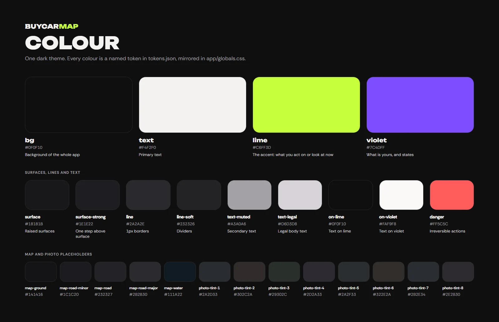
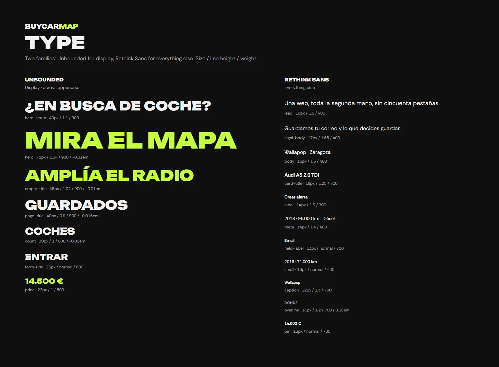
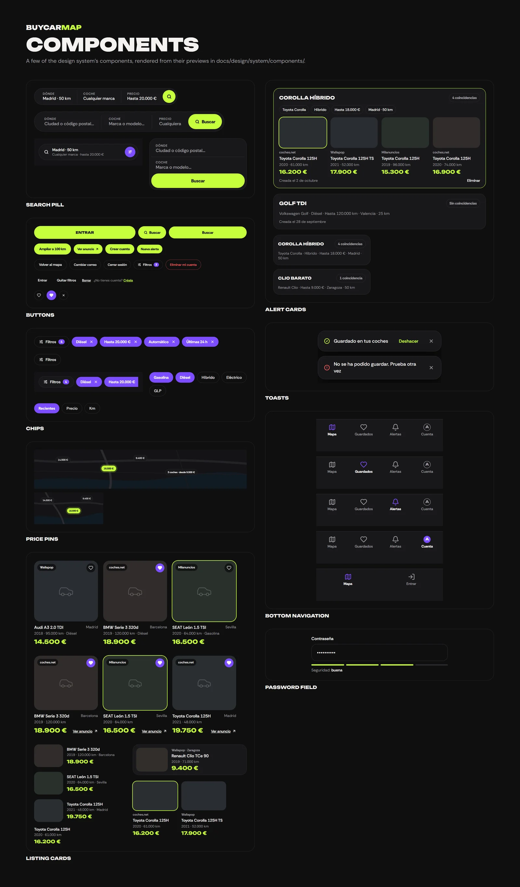
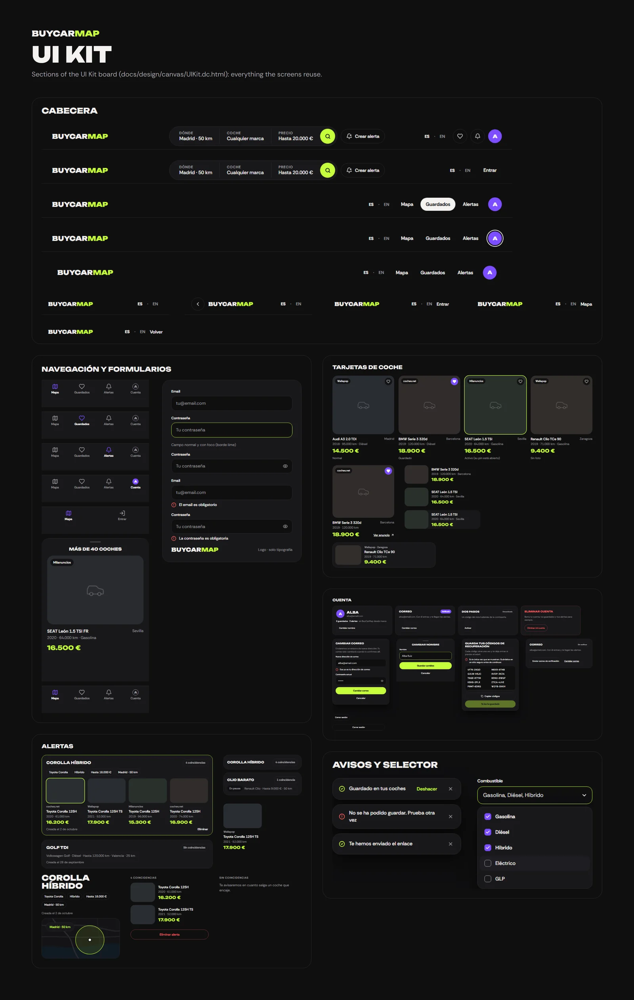

# Design — BuyCarMap 2.0

The approved redesign of BuyCarMap (2026-10-11): what every screen should look like, and the system
it is built from. All seven phases are implemented ([roadmap](roadmap.md)); it stays the reference the
redesign specs and code are checked against.

## At a glance

How the old interface became this one, screen by screen: [The 2.0 redesign](redesign-2.0.md).

## Where it lives

**This folder is the source of truth**, and the design is viewed in the Claude Design project
[BuyCarMap 2.0](https://claude.ai/design/p/838f9ee3-0bcc-4990-8c5a-5a685806db48), which is published
from it (its id is pinned in `.design-sync/config.json`):

| | Source here | In the project |
| --- | --- | --- |
| Screens and UI kit | `docs/design/canvas/` | groups "Pantallas" and "UI Kit", one card per artboard in journey order |
| Design system | `docs/design/system/` | tokens, README and one card per component |

A design change is made here, shown to the owner, and republished to the project in the same pull
request, so the two never differ.

The first version lived in two claude.ai artifacts, a canvas
(`https://claude.ai/artifact/9TxaFxZY17u59e2L1DEZjf`) and a design system
(`https://claude.ai/artifact/Rzes1CqbkBtFkVBjG2nihj`). They are frozen at commit `944a770`: an
artifact created from an artifact type cannot be published to from a coding session.

A Figma copy exists too ([BuyCarMap — Rediseño](https://www.figma.com/design/j0j8TrycVYlM50otNVJNdU)),
with the first screens and a component library. It is well behind the canvas — it predates the
violet accent, the illustrations and every F0 screen — and is not kept in sync. The canvas wins.

## The canvas

Page "Pantallas", every screen in journey order, each artboard a desktop screen (1440 × 900)
beside its phone screen (390 × 844); the landing, sign in, saved cars, alerts, register, account and the legal pages also carry a laptop screen (1024 × 900):

- `R3-landing.dc.html`, `R3-login.dc.html` — the landing and sign in.
- `F0-saltar-contenido.dc.html` — the «Saltar al contenido» skip link, focused over the landing
  header: the first Tab on any page.
- `F0-registro.dc.html`, `F0-confirmar.dc.html`, `F0-contrasena.dc.html`,
  `F0-nueva-contrasena.dc.html` — register, confirm the account, request and set a new password,
  each with a phone variant of its follow-up state (check your inbox, account ready, expired link).
- `F7-registro-estados.dc.html`, `F7-confirmar-estados.dc.html`, `F7-contrasena-estados.dc.html` —
  check your inbox after registering (with resend), inline errors, the strength meter's issues and
  hint, and register on a laptop; account ready on desktop, the confirm form on the phone, the
  expired confirmation link, and confirming a new email address (form, done, expired link); the
  missing widths of request and set a new password, and a rejected new password.
- `R2Base.dc.html` — the map screen. `R3-mapa-detalle.dc.html` imports it and adds a car's preview
  and the phone filters sheet, so keep both.
- `F3-mapa-portatil.dc.html` — the map on a laptop (1024 × 900), signed in and out: below 1440px
  the header band takes three rows, the pages navigation on the first, the search group on the
  second and the filters on the third.
- `F3-mapa-foco.dc.html` — the map with keyboard focus: the focus ring drawn inside the map's edge,
  following its radius, under the pins and the zoom (desktop), and inside the visible strip of the
  map (phone).
- `F3-mapa-filtros.dc.html`, `F3-mapa-crear-alerta.dc.html`, `F3-crear-alerta-estados.dc.html` — the
  map with the filters open (the desktop dropdown and the phone sheet), with «Crear alerta» open, and
  creating an alert from a search that is too broad and once it is created.
- `F3-buscador-donde.dc.html`, `F3-buscador-coche.dc.html`, `F3-buscador-precio.dc.html` — the map
  with each search pill segment open (Dónde, Coche, Precio) on desktop; on the phone, the map with
  the search row and the «Buscar» sheet it opens.
- `F3-mapa-tu-ubicacion.dc.html`, `F3-buscador-tu-ubicacion.dc.html` — the map centred on the user's
  position, with «Tu ubicación · 50 km» in the pill and the phone row and the 50 km zone drawn
  around it; and the «Dónde» popover and the phone «Buscar» sheet with «Tu ubicación» as the place.
- `F0-estado-cargando.dc.html`, `F0-estado-sin-resultados.dc.html`,
  `F0-estado-error-busqueda.dc.html`, `F0-estado-mapa-no-disponible.dc.html` — the map loading,
  with no results, with a failed search and in a browser without WebGL.
- `R3-favoritos.dc.html`, `F5-guardados-coche.dc.html`, `F5-guardados-estados.dc.html`,
  `F0-estado-guardados-vacio.dc.html` — saved cars, with a car open (the preview on desktop, the car sheet
  on the phone), on a laptop, scrolled down a long list, with several cars at one point on the map,
  after removing one (desktop and phone), loading, and empty.
- `R3-alertas.dc.html`, `F6-alerta.dc.html`, `F6-alerta-estados.dc.html`, `F6-alertas-escritorio.dc.html`,
  `F6-alerta-escritorio.dc.html`, `F6-alerta-mas-estados.dc.html`, `F0-estado-alertas-vacio.dc.html` —
  alerts; an alert's page on the phone; that page scrolled to the end, a match open, the delete
  confirmation and an alert with no matches (phones only); a paused alert, an alert with no place
  and several matches at one point, alerts on a laptop and loading (desktop); an alert's page on
  desktop and its delete dialog; on the phone, an alert with no place, a long list scrolled, a
  saved match and both pages loading; and no alerts.
- `F0-cuenta.dc.html` — account. `F7-cuenta-editar.dc.html`, `F7-cuenta-dos-pasos.dc.html`,
  `F7-cuenta-sesiones-google.dc.html`, `F7-cuenta-eliminar-y-mas.dc.html` — editing each card in a
  dialog (desktop) or sheet (phone): name, email, password and the unverified email; two-factor
  setup, recovery codes and managing it; sessions and the Google card states; deleting the account,
  the data export busy, a Google-only account, loading and a laptop.
- `F0-legal.dc.html` — privacy and terms. `F7-legal-estados.dc.html` — the phone table of contents
  open, the current section while reading, terms and a laptop.
- `F0-estado-error-pagina.dc.html` — any page that failed to load. `F7-no-existe.dc.html` — a page
  that does not exist, signed in and out, and the page error signed out.

Page "UI Kit": `UIKit.dc.html`, every reusable piece in its states (colours, type, buttons,
search pill and the filter row, the search pill popovers and the phone «Buscar» sheet, the
filters panel, the «Crear alerta» popover and sheet, map pins, alert zone and preview, car cards,
navigation and the phone tab bar, the phone car and confirm sheets, the phone alert page, form
fields, loading and empty states, account cards, the password meter and the footer).

The listings, prices and photos in the screens are made-up examples.

`canvas/illus/` holds the two illustrations the landing and sign-in screens use, "Vehicle sale" and
"By my car" from [Storyset](https://storyset.com) (Freepik), "Cuate" style, background hidden and
recoloured to the palette. Their free licence requires the credit "Illustrations by Storyset" with a
link, so the shipped pages must carry it.

## The design system

[`system/README.md`](system/README.md) is the brand book: voice and copy rules, colour, type,
screen structure, icons and accessibility. `system/tokens.json` holds every token;
`system/components/<Name>/` holds each component's guidelines and preview:

- [Button](system/components/Button/README.md)
- [Chip](system/components/Chip/README.md)
- [SearchPill](system/components/SearchPill/README.md)
- [SearchPopover](system/components/SearchPopover/README.md)
- [Headline](system/components/Headline/README.md)
- [ListingCard](system/components/ListingCard/README.md)
- [PricePin](system/components/PricePin/README.md)
- [AlertZone](system/components/AlertZone/README.md)
- [MapPreview](system/components/MapPreview/README.md)
- [BottomSheet](system/components/BottomSheet/README.md)
- [BottomNav](system/components/BottomNav/README.md)
- [Wordmark](system/components/Wordmark/README.md)
- [EmptyState](system/components/EmptyState/README.md)
- [AccountCard](system/components/AccountCard/README.md)
- [PasswordField](system/components/PasswordField/README.md)
- [Footer](system/components/Footer/README.md)
- [Toast](system/components/Toast/README.md)
- [Select](system/components/Select/README.md)
- [StatusPill](system/components/StatusPill/README.md)
- [HeaderNav](system/components/HeaderNav/README.md)
- [AlertCard](system/components/AlertCard/README.md)
- [GoogleButton](system/components/GoogleButton/README.md)
- [MapZoom](system/components/MapZoom/README.md)
- [FilterSheet](system/components/FilterSheet/README.md)
- [CreateAlert](system/components/CreateAlert/README.md)
- [Cover](system/components/Cover/README.md)
- [LegalToc](system/components/LegalToc/README.md)
- [SkipLink](system/components/SkipLink/README.md)

## Relation to `DESIGN.md`

The root `DESIGN.md` still describes the current app ("Cartographic Modern"). It is replaced from
this design system when the redesign is implemented, not before.
