# BuyCarMap 2.0 — the redesign

## Before

BuyCarMap 0.4 worked, but it looked like many other web apps. Its theme was the stock token set of a
component starter (`--primary`, `--accent`, even `--sidebar-primary` in an app with no sidebar),
tinted a deep blue-grey (`#0F1419`) with an amber accent (`#E8A849`). Text was Plus Jakarta Sans,
prices were set in JetBrains Mono, and a toggle switched between that dark theme and a light one.
The landing was a centred headline and a search box; sign in was a form in a card; saved cars,
alerts and the account were plain lists and stacked forms.

## What was done

The redesign started with a design system, not with the screens:

- **Tokens** for colour, type, spacing, radii and shadows, in one file
  ([`system/tokens.json`](system/tokens.json)), mirrored in `app/globals.css`.
- **One dark theme**: near-black with a lime accent (`#C6FF3D`) for what you act on now and violet
  (`#7C4DFF`) for what is yours. The light theme and its toggle are gone.
- **Two typefaces**: Unbounded, always in capitals, for headlines, titles and prices; Rethink Sans
  for everything else.
- **Components** with their states, each with its own preview ([`system/components/`](system/components/)),
  and a **UI Kit** board that collects everything the screens reuse
  ([`canvas/UIKit.dc.html`](canvas/UIKit.dc.html)).

Then every screen was drawn on the design canvas ([`canvas/`](canvas/)), at desktop and phone
sizes, together with its empty, loading and error states. A screen was specified only once its
design was approved, and built only once its specification was approved and its tests were written.
The work went in seven phases, each with its own spec and tests: foundation (F1), navigation (F2),
the map and search (F3), landing and sign in (F4), saved cars (F5), alerts (F6) and the remaining
pages (F7). The phases are listed in the [roadmap](roadmap.md).

## Result

The same product and the same data, with a look of its own: the map is the screen, prices are the
loudest thing on it, and the phone has a bottom navigation and sheets instead of shrunk desktop
pages. Some screens did more than change their look. Saved cars now have their own map and
sorting. An alert shows its zone on a map and the cars it found. The account page is a set of
cards rather than one long form.

The screenshots below were taken from both versions with the same fictional data: one account,
the same listings from the three sources, six saved cars and three alerts. The car photos are
drawn placeholders. Four screens are shown at desktop (1440 × 900); landing and the map are also
shown at phone (390 × 844).

### Landing — `/`

| Before | After |
| --- | --- |
| 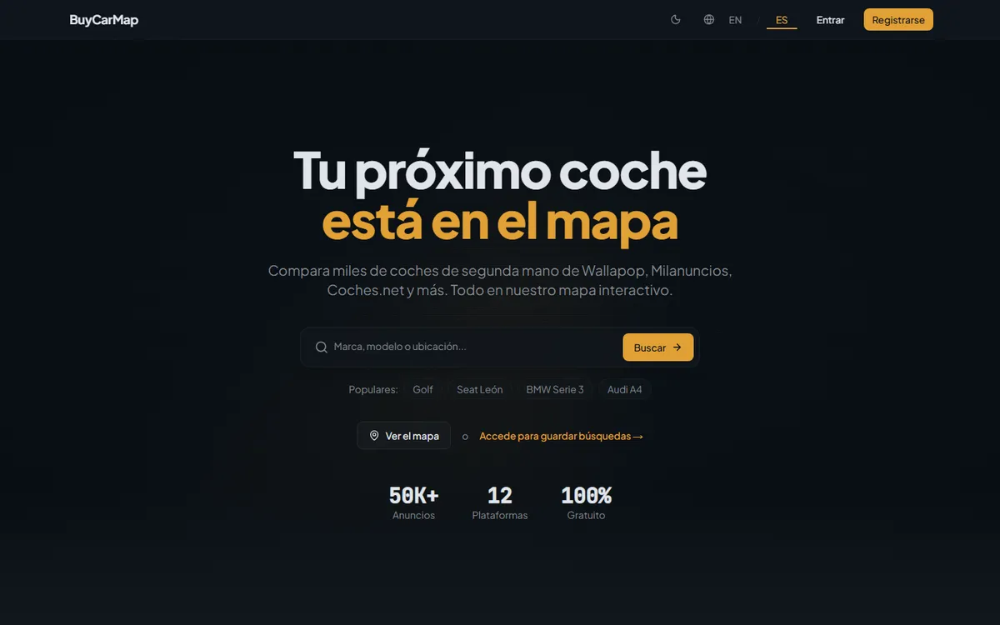 | 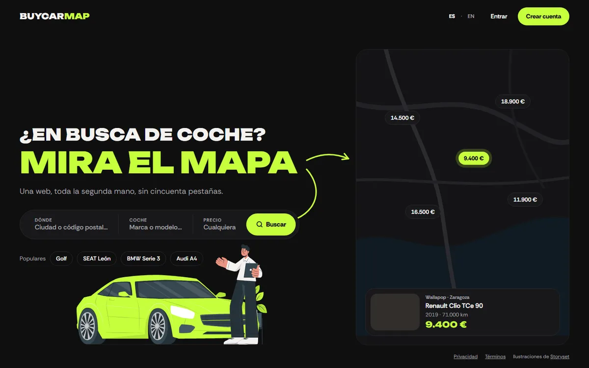 |

### Alerts — `/alerts`

| Before | After |
| --- | --- |
| 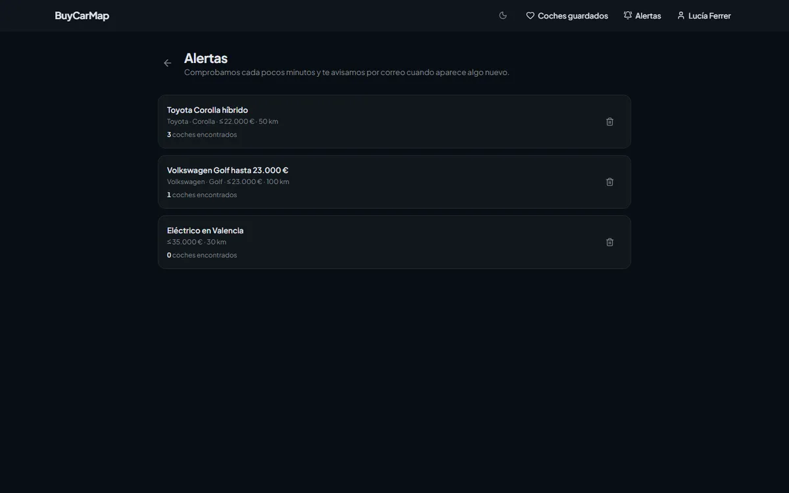 | 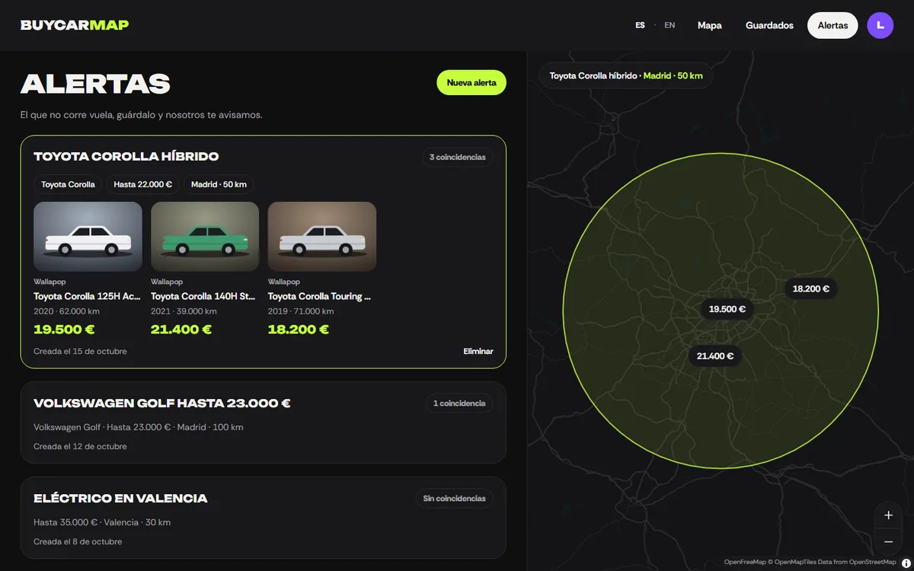 |

### Saved cars — `/favorites`

| Before | After |
| --- | --- |
| 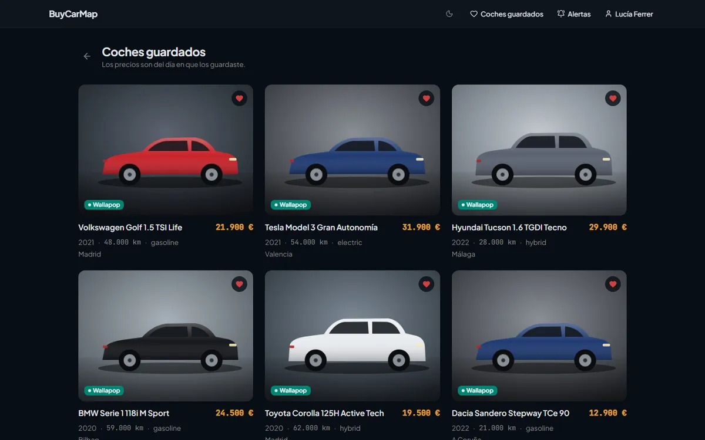 | 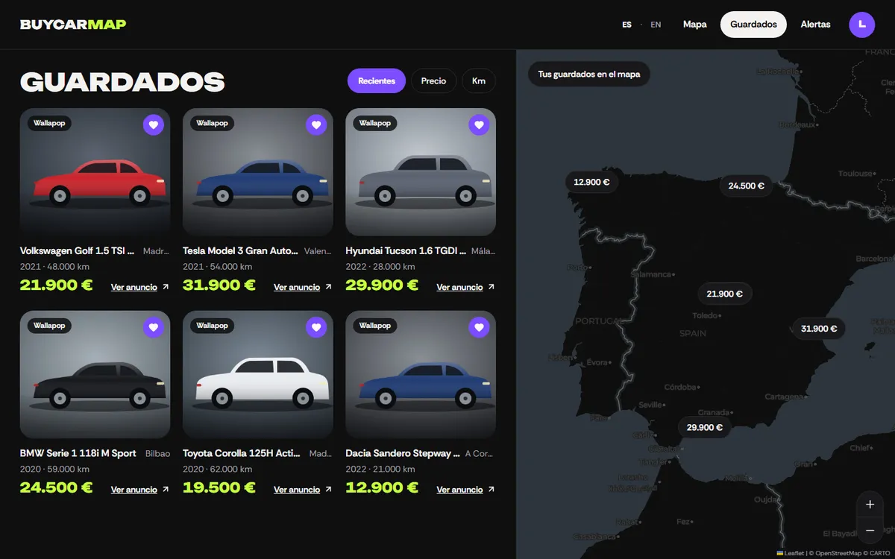 |

### Map with results — `/map`

| Before | After |
| --- | --- |
| 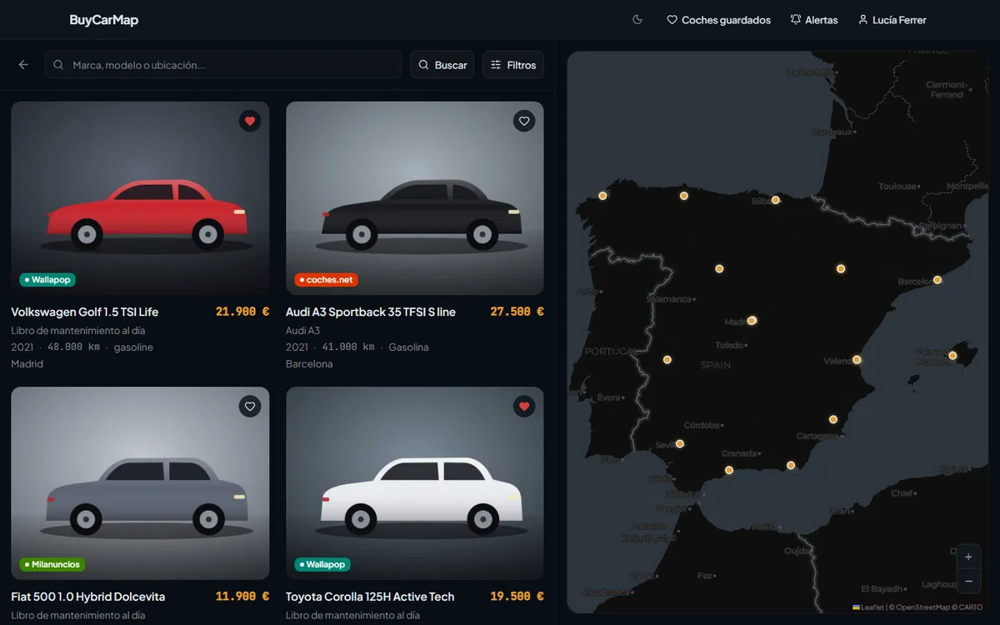 | 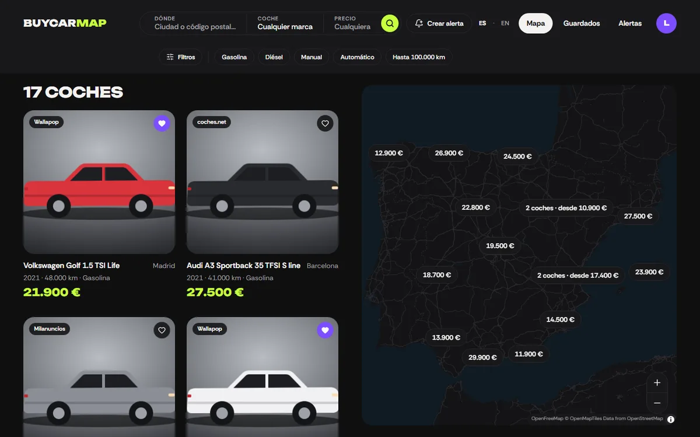 |

## On the phone

### Landing — `/`

| Before | After |
| --- | --- |
| 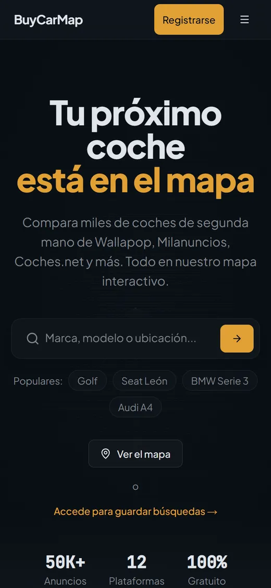 | 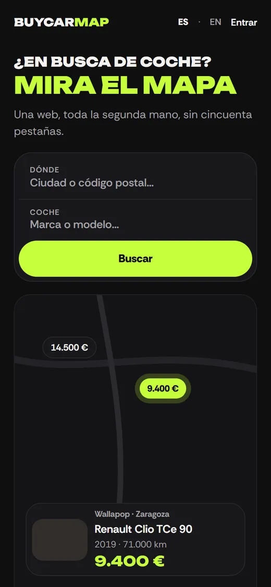 |

### Map with results — `/map`

| Before | After |
| --- | --- |
| 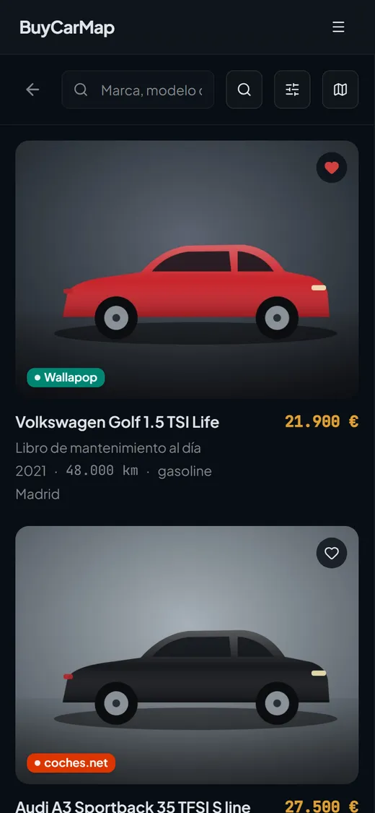 | 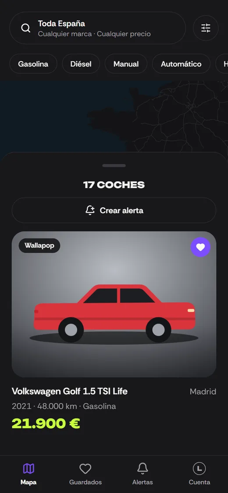 |
